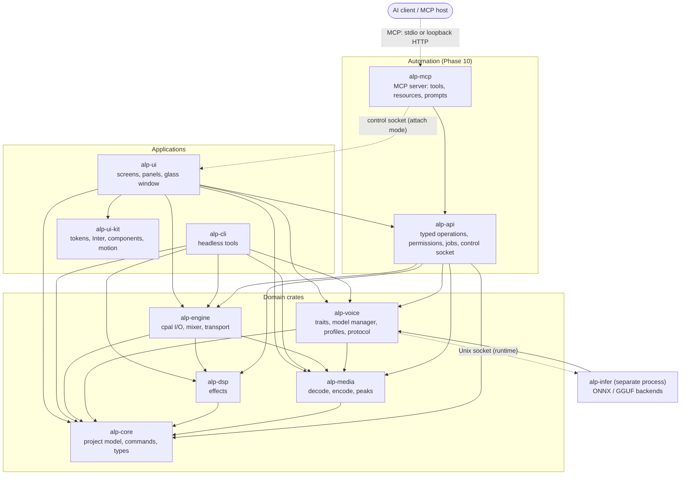
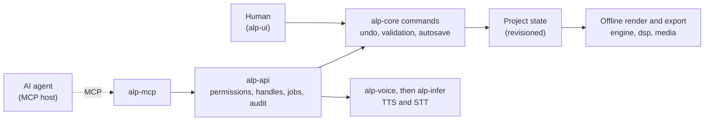

# Audio Labs Pro (ALP) — Agent Build Plan

> **Product name: Audio Labs Pro** (renamed from "Audio Lab Pro"). **ALP** is the abbreviation; the crate prefix stays `alp-` and the binary stays `alp`. Use the full name "Audio Labs Pro" in all user-facing text (window title, About dialog, desktop file, docs, packaging) and "ALP" only as shorthand in code and internal docs.
> Linux-only, English-only, fully-Rust audio studio: multitrack recording/editing/export + local AI TTS, dictation, voice profiles, optional voice cloning, and a local MCP server so AI agents can edit, create and export audio (Phase 10).
> Status: **planning**. Items marked **[VERIFY]** came from secondary sources and must be confirmed against primary docs/model cards before relying on them.

---

## 0. Rules for the building agent

1. Work **one phase at a time**. Do not start Phase N+1 until every acceptance criterion of Phase N passes.
2. Record every significant technical choice as an ADR in `docs/adr/NNNN-title.md` (context, options, decision, consequences).
3. Before adding **any** crate or model: record name, version, and license in `THIRD_PARTY.md`. Reject anything whose license conflicts with the app's license (see Open Decisions).
4. Never copy code from Audacity (GPL) or any project whose license is incompatible. Study behavior, not source.
5. `cargo fmt`, `cargo clippy -- -D warnings`, and `cargo test` must pass before every commit. Commit small and often.
6. No telemetry. The only outbound network traffic is **user-initiated model downloads**. The optional MCP server (Phase 10) is local-only: stdio by default, or a loopback or Unix-socket endpoint the user switches on. It never makes outbound connections.
7. Never allocate, lock, or block inside the real-time audio callback.
8. When an Open Decision blocks progress, stop and ask the human instead of guessing.
9. Every phase ends with: updated module docs, an updated architecture diagram (if structure changed), updated `CHANGELOG.md`, a demo script, green guard scripts (file length, dependency directions, module docs), and a short "what's next" note.

### 0.1 Modular code rules (always apply)
1. **Modular by default.** One responsibility per file and per module. Split by responsibility (types / logic / I/O / tests), never arbitrarily.
2. **Hard limit: no source file over 1,500 lines** (code, comments, and inline tests all count). If a file approaches ~1,000 lines, split it proactively. Only files marked `// @generated` are exempt.
3. Keep `mod.rs` / `lib.rs` thin: module declarations and deliberate re-exports only.
4. Move tests into separate files (`tests/` or `*_tests.rs`) once they would push a file past ~600 lines.
5. Prefer small functions (soft limit ~80 lines) and small public APIs; hide internals with `pub(crate)`.
6. Cross-module access goes through public traits/types only. Never reach into another module's internals.
7. Enforce with `scripts/check-file-length.sh`: CI fails above 1,500 lines and warns above 1,000.

### 0.2 Architecture rules
1. The **architecture diagram in Section 3.6 is the source of truth**. In Phase 1, copy it to `docs/architecture/ARCHITECTURE.md` and keep it current.
2. Follow the **allowed dependency directions** in 3.6. A new dependency edge needs an ADR and a diagram update **in the same commit**.
3. `scripts/check-deps.sh` (built on `cargo metadata`) fails CI on forbidden edges.
4. If code and diagram disagree, fix the code or deliberately update the diagram. Never leave drift.
5. **All project changes are `Command`s in `alp-core`.** The UI never mutates project state any other way. Phase 10 adds a second client (the automation API behind MCP) over the same commands, so undo/redo, autosave and validation behave identically for humans and AI.
6. **No feature exists only in MCP.** If an AI tool needs a capability, implement it in the right domain crate (core, media, dsp, voice, engine) so the UI can use it too. `alp-api` and `alp-mcp` hold schemas, permissions, sessions and transport only, never audio or editing logic.

### 0.3 Documentation rules
1. **Every module gets its own doc file** under `docs/modules/`: `docs/modules/<crate>.md`, plus `docs/modules/<crate>/<submodule>.md` for each significant submodule.
2. Required sections: Purpose · Public API · Data flow · Allowed dependencies · Threading / real-time notes · Error handling · Testing · Known limits.
3. Docs change in the **same commit** as the code they describe. Also write `//!` module docs in the source.
4. `scripts/check-docs.sh` fails CI if a crate or top-level module has no doc file.
5. Index everything in `docs/README.md`.

### 0.4 UI rules (apply once D2 = iced is confirmed in Phase 0)
If Phase 0 selects a different toolkit, port these rules to it and record an ADR.
1. **Toolkit:** iced, pinned to an exact version. Upgrades are their own task with an ADR, because iced APIs change between releases **[VERIFY policy]**.
2. **Font:** **Inter** for all UI text. Bundle it with `include_bytes!`, use a small set of static weights (Regular, Medium, SemiBold), and ship the SIL OFL license text in `assets/fonts/` and `THIRD_PARTY.md`. Check tabular-number support for timecodes and meters; if the text stack can't do it, use fixed-width layout cells for numeric readouts **[VERIFY]**.
3. **Components:** every screen uses components from the **`alp-ui-kit`** crate. **No raw `iced::widget::button`** (or any raw widget that has a kit equivalent) in screen code. Enforce with a clippy `disallowed-methods` list in `alp-ui` **[VERIFY]**.
4. **About interior.dev:** it is a React/shadcn-style library that depends on the npm `motion` package, so it **cannot be a dependency** of a Rust/iced app. Use it as a **design and interaction reference** (command palette, dropdown, popover, modal, accordion, loading button, icon morph, tree view, and similar) and re-implement the behaviors in `alp-ui-kit`.
5. **iced component libraries:** evaluate `iced-plus` (design tokens, theme bridge, 30+ components, MIT, early 0.1 release), `iced_aw` (extra widgets), and `iced_ui` in the Phase 0 design-system spike. Adopt one only if it matches the pinned iced version, is maintained, and has a compatible license. Otherwise build in-house. Record the outcome as an ADR (D7).
6. **Buttons:** one `Button` API in `alp-ui-kit` with variants (primary, secondary, ghost, icon, destructive, toggle, loading), states (hover, pressed, focused, disabled), and built-in motion.
7. **Motion across the UI:** one `motion` module in `alp-ui-kit` wraps the chosen animation crate (candidates: `lilt`, a dependency-free library for interruptible, time-based transitions; `iced_anim`, springs and transitions for iced; chosen in Phase 0 as D8). Define motion tokens: durations about 120 / 200 / 320 ms, ease-out by default, spring for panels.
   - **Animate:** hover/press, panel open/close/drag-settle, tab and section changes, dropdowns and popovers, modals and scrims, toasts, list insert/remove, loading states.
   - **Don't animate:** waveform data, meters, or anything that could misrepresent audio. Avoid animating blur radius continuously (expensive); animate opacity and position instead.
   - Request redraws only while an animation is running (no idle CPU burn) and pause when the window is unfocused.
   - Provide a **Reduce motion** setting that disables or shortens animations.
8. **Theme tokens** (color, glass tint, radius, spacing, type scale, motion) live in `alp-ui-kit`. Screens never hard-code values.

---

## 1. Product scope

### In scope
- Multitrack recording, editing, mixing, and export.
- Local TTS: text → audio, built-in voices, voice profiles, voice generation.
- Optional voice cloning via downloadable heavy models.
- Local dictation (speech → text), transcript export.
- Frosted-glass UI with modular floating panels (Motrix 2.0-inspired).
- Linux only (Wayland + X11), English only.
- Local MCP server (Phase 10): AI agents can create, edit, mix, transcribe, narrate and export audio, headless or live in the app.

### Out of scope (v1)
- Windows/macOS, non-English UI or models.
- Cloud APIs or accounts. (The Phase 10 MCP server is local-only.)
- Plugin hosting (CLAP/LV2) and MIDI — post-1.0 candidates.
- Video editing.

---

## 2. Decisions

### Locked (from planning discussion)
| Topic | Decision |
|---|---|
| Language | Rust for everything |
| Platform | Linux only |
| Language support | English only |
| Models | Local only; built-in light tier + optional heavy download tier |
| Licensing preference for models | Apache 2.0 (MIT acceptable as equally permissive) |
| UI direction | Motrix 2.0-like, floating panels, frosted-glass backdrop |
| UI toolkit | iced, **pending Phase 0 confirmation** (D2) |
| Code structure | Modular; no source file over 1,500 lines; one doc file per module; architecture diagram followed |
| UI font | Inter |
| UI components | In-house `alp-ui-kit` (interior.dev as design reference only); iced libraries evaluated in Phase 0 |
| UI motion | Motion across the UI through a single `motion` module; honors Reduce motion |
| App name | **Audio Labs Pro** (ALP); crate prefix `alp-` and binary `alp` unchanged |
| AI integration | Local MCP server in Phase 10: AI can edit, create and export audio; local-only, stdio by default, permissioned, every AI edit undoable |

### Open (resolve in Phase 0)
| # | Decision | Notes |
|---|---|---|
| D1 | App license (open source vs paid) | Affects Slint, GPL libs, LAME (LGPL), espeak-ng (GPL) |
| D2 | Confirm UI toolkit: **iced** (target) vs Tauri 2 vs Slint | Phase 0 UI spike; Section 0.4 applies once iced is confirmed |
| D3 | Heavy-model runtime: GGUF via audio.cpp/ggml vs `candle` vs Python sidecar | Decide from the Phase 0 model spike |
| D4 | Internal audio format | Proposed: f32, 48 kHz default, per-project override |
| D5 | Export formats at v1 | Proposed: WAV, FLAC, MP3, OGG Vorbis; Opus later |
| D6 | Dictation model | Proposed: Moonshine (MIT, English); fallback Whisper `.en` (MIT) |
| D7 | Component library: adopt an iced crate vs build in-house | Evaluate `iced-plus`, `iced_aw`, `iced_ui`; interior.dev is React-only |
| D8 | Animation crate: `lilt` vs `iced_anim` | Pick from the Phase 0 motion spike (frame time, idle CPU) |
| D9 | MCP SDK: official `rmcp` vs a thin hand-rolled layer, and the target spec revision | Resolve in Phase 10.0. Latest revision is 2026-07-28 (stateless, Tasks extension, multi-round-trip input). Confirm what the pinned `rmcp` implements **[VERIFY]** |
| D10 | Live-control transport for attach mode: Unix-socket proxy (preferred) vs embedded loopback Streamable HTTP | Resolve in Phase 10.0 |
| D11 | Default AI permission tier and approval mode | Proposed: Edit + Export (exports folder only), confirm destructive actions, checkpoint at session start. The human can choose Observe-only or Review mode |
| D12 | Reverse-DNS app ID for Flatpak and the desktop file | Needs a domain or project URL the human controls. Ask the human in Phase 9; do not invent one |

---

## 3. Architecture

### 3.1 Workspace layout (Cargo workspace)
```
alp/
├─ crates/
│  ├─ alp-core/        # types, project model, commands (undo/redo), serialization
│  ├─ alp-engine/      # real-time audio: cpal I/O, mixer, transport, recorder
│  ├─ alp-media/       # decode (symphonia), encode, resample, peak pyramid, tags
│  ├─ alp-dsp/         # effects: EQ, compressor, limiter, de-esser, denoise, loudness
│  ├─ alp-voice/       # TTS/STT/clone traits, model manager, voice profiles
│  ├─ alp-infer/       # inference worker process (ONNX / GGUF backends)
│  ├─ alp-ui/          # UI app (iced if confirmed): screens, panels, glass window
│  ├─ alp-ui-kit/      # design tokens, Inter font, components (buttons etc.), motion
│  ├─ alp-api/         # (Phase 10) automation API: typed operations, handles, permissions, jobs, audit log, control socket
│  ├─ alp-mcp/         # (Phase 10) MCP server adapter: tools, resources, prompts, transports
│  └─ alp-cli/         # headless export/TTS/transcribe for tests and scripting
├─ docs/
│  ├─ README.md                       # docs index
│  ├─ architecture/ARCHITECTURE.md    # diagram + dependency rules (source of truth)
│  ├─ modules/                        # one .md per crate/module: <crate>.md, <crate>/<submodule>.md
│  ├─ mcp/                            # (Phase 10) TOOLS.md, WORKFLOWS.md, SECURITY.md, CLIENT_SETUP.md, AGENT_GUIDE.md, EVAL.md
│  └─ adr/
├─ scripts/            # check-file-length.sh, check-deps.sh, check-docs.sh
├─ assets/             # icons, fonts (Inter + OFL license), themes, model manifest
├─ THIRD_PARTY.md
└─ ALP_BUILD_PLAN.md
```

### 3.2 Threads and processes
- **UI thread**: rendering and input only.
- **Audio thread** (cpal callback): reads clips from pre-decoded buffers; communicates via lock-free ring buffers (`rtrb` or `ringbuf` [VERIFY choice]).
- **Worker pool**: decode, peak generation, export, effect rendering; every job has a cancellation token and progress channel.
- **Inference worker process** (`alp-infer`): runs TTS/STT/clone models out-of-process so a GPU/VRAM crash or OOM never takes down the editor. Talks to the app over a Unix socket with a small versioned protocol. Also keeps any GPL phonemizer behind a process boundary (get license advice if relevant to D1).
- **MCP server process** (`alp-mcp`, Phase 10): a separate process, spawned by the AI client over stdio or started by the user. It never touches the audio thread. In headless mode it owns a session (offline render only, no audio device). In attach mode it forwards calls over a local control socket to the running UI, which applies them through the same command channel as user input.

### 3.3 Non-destructive editing model
- Source media is **immutable** and imported into the project's `media/` folder (or referenced).
- A project is a set of **tracks**, each holding **clips**: `{source_id, source_range, timeline_start, gain, fade_in, fade_out, envelope, effects[]}`.
- Edits (cut, trim, split, move, fade) only change clip data. Undo/redo is a **command stack** (every mutation is a `Command` with `apply` / `revert`).
- **Peak pyramid**: min/max peaks at several zoom levels, built once per source and cached in `peaks/`.
- Rendering (playback, bounce, export) walks the clip graph; the same effect code is used for live preview and offline render.

### 3.4 Project format
- Directory-based `*.alp/` with `project.json` (versioned schema + migrations), `media/`, `peaks/`, `renders/`, `voices.ref` (links to voice profiles).
- Atomic saves (write temp, fsync, rename) and autosave with crash recovery.

### 3.5 Voice abstractions (alp-voice)
```rust
trait TtsBackend  { fn id(&self) -> &str; fn voices(&self) -> Vec<VoiceInfo>;
                    fn synthesize(&self, req: TtsRequest) -> Result<PcmStream>; }
trait CloneBackend: TtsBackend { fn create_profile(&self, reference: &Path, transcript: Option<&str>) -> Result<VoiceProfile>;
                                 fn synthesize_with(&self, profile: &VoiceProfile, req: TtsRequest) -> Result<PcmStream>; }
trait SttBackend  { fn transcribe(&self, pcm: PcmChunk) -> Result<Segment>; fn streaming(&self) -> bool; }
```
Backends are registered from the model manifest; the UI only talks to the traits.

### 3.6 Architecture diagram and dependency rules
Initial diagram (copy to `docs/architecture/ARCHITECTURE.md` in Phase 1 and keep it current). Solid arrows are compile-time dependencies; the dotted arrow is the runtime socket connection.



Allowed dependency directions (enforced by `scripts/check-deps.sh`):
- `alp-core` depends on no other ALP crate.
- `alp-media` and `alp-dsp` depend on `alp-core` only.
- `alp-engine` depends on core, media, and dsp. Never on UI or voice.
- `alp-voice` depends on core and media. It reaches `alp-infer` only through the socket protocol at runtime.
- `alp-infer` depends on `alp-voice` (traits and protocol), core, and media.
- `alp-ui-kit` depends on iced only (no ALP crates).
- `alp-ui` depends on ui-kit, core, engine, media, voice, and (Phase 10) api. It never touches cpal or ONNX directly.
- `alp-cli` depends on core, engine, media, dsp, and voice. Never on UI.
- `alp-api` (Phase 10) depends on core, engine (offline render only; no cpal output in headless mode), media, dsp, and voice. Never on UI, and never on ONNX or cpal directly.
- `alp-mcp` (Phase 10) depends on `alp-api` and the MCP SDK only. In attach mode it reaches the running UI through the control socket at runtime, never by linking `alp-ui`.

### 3.7 Automation architecture (Phase 10)
Two clients drive the same engine: the human in the UI and AI agents through MCP. Both go through `alp-core` commands.



- **Headless mode** (scripts, CI, default): `alp-mcp --workspace <dir>` is spawned by the AI client over stdio. It owns the project session, renders offline, and needs no audio device or GUI.
- **Attach mode** (live): the running app hosts a control socket (off by default; the user turns on "Allow AI control"). `alp-mcp --attach` forwards calls to it, so the user watches edits happen and can undo them. Human and AI edits are serialized through one command queue.
- **No implicit state.** Every tool takes explicit handles (`project_id`, `track_id`, `clip_id`, `media_id`, `job_id`). There is no "current project". This matches the stateless MCP revision (2026-07-28) and works on any transport.
- **Revisions.** Each project has a `revision` counter. Mutating tools return the new revision and accept `expected_revision` to detect concurrent edits.
- **Long jobs** (TTS, transcription, analysis, export) run in a job manager. Clients that support the MCP Tasks extension get a task handle. Other clients get progress notifications and a `job_id` to poll with `job_status`.
- **Results are written for models:** a short text summary plus `structuredContent` that matches an `outputSchema`; large lists are paginated; waveform and spectrogram renders come back as `image` content; files come back as `resource_link`s.

---

## 4. Tech stack (proposed)

| Concern | Choice | Notes |
|---|---|---|
| Audio I/O | `cpal` | Used by nearly all Rust audio projects; needs ALSA dev files |
| Decoding | `symphonia` | Decode-only; FLAC/WAV/MP3/AAC/Vorbis/ALAC/AIFF. Opus decode gap reported as of 2026-03 **[VERIFY]** |
| Encoding | `hound` (WAV); FLAC/MP3/OGG encoders **[VERIFY crates + licenses]** | LAME is LGPL |
| Resampling | `rubato` | API changed at 1.0 — pin the version |
| Loudness | `ebur128` | LUFS normalization and metering |
| Denoise | `nnnoiseless` (RNNoise port) | Speech-oriented; build a classical-DSP fallback |
| DSP blocks | `fundsp`, own biquads | EQ, compressor, limiter, de-esser |
| FFT/spectrogram | `rustfft` / `realfft` **[VERIFY]** | |
| ONNX inference | `ort` | Kokoro, Kitten, Moonshine |
| Heavy models | see D3 | audio.cpp/GGUF route runs Qwen3-TTS, VoxCPM2, OmniVoice, Kokoro **[VERIFY]** |
| UI | per D2 (iced target) | wgpu rendering; custom waveform widget |
| UI font | **Inter** (SIL OFL) | Bundled static weights; license text in `THIRD_PARTY.md` |
| UI components | `alp-ui-kit` (in-house); candidates to evaluate: `iced-plus`, `iced_aw`, `iced_ui` | interior.dev is React-only: design reference, not a dependency (D7) |
| Motion | `lilt` or `iced_anim` (D8) | Wrapped by `alp-ui-kit::motion` |
| Window blur | `ext-background-effect-v1`, KDE blur protocol, X11 property | Needs raw window handle access **[VERIFY in iced]** |
| Serialization | `serde`, `serde_json` | |
| Async/jobs | `tokio` or `rayon` + channels | Keep the audio thread free of both |
| MCP server (Phase 10) | `rmcp`, the official Rust MCP SDK (`#[tool]` and `#[prompt]` macros, stdio and Streamable HTTP server transports, optional `elicitation` feature) | Pin a version that includes the HTTP `Host`-header protection (fixed in 1.4.0). Confirm which spec revision it implements (D9) **[VERIFY]** |
| Tool schemas | `schemars` + `serde` | JSON Schema 2020-12 `inputSchema` and `outputSchema`; schema snapshot tests **[VERIFY crate choice]** |
| Control socket | Unix domain socket + JSON-RPC, `SO_PEERCRED` uid check | Mode 0600 under `$XDG_RUNTIME_DIR` |
| Images for AI | `png` or `image` crate **[VERIFY]** | Waveform and spectrogram renders returned as MCP image content |

---

## 5. Model strategy

### 5.1 Built-in (ships with installer or first-run) — English, lightweight
| Role | Model | License | Approx. size | Notes |
|---|---|---|---|---|
| Instant-start TTS | **KittenTTS nano** | Apache 2.0 | ~25–80 MB | 8 voices, English, no cloning |
| Main TTS | **Kokoro-82M** | Apache 2.0 | ~310 MB ONNX (fp32 conversion) | Fast on CPU, many fixed voices; no cloning |
| Dictation | **Moonshine tiny/base** | MIT (English models) | ~27M / 62M params | English-only; streaming-friendly |

### 5.2 Optional downloads (cloning + voice design) — Apache 2.0
| Model | License | Approx. size | Capability |
|---|---|---|---|
| **Qwen3-TTS 0.6B Base** ("Fast") | Apache 2.0 | ~2 GB (Q8 GGUF) | ~3 s reference cloning; ~4 GB VRAM class |
| **Qwen3-TTS 1.7B Base** ("Best") | Apache 2.0 | ~2.7 GB (Q8 GGUF) | Higher quality cloning; ~8 GB VRAM class |
| **VoxCPM2** | Apache 2.0 | **[VERIFY]** | Voice design from text description + controllable cloning |
| **OmniVoice** | Apache 2.0 | **[VERIFY]** | ~3–10 s reference cloning; Qwen3-0.6B backbone |

### 5.3 Do NOT use
- **F5-TTS** weights (CC-BY-NC), **XTTS-v2** (Coqui CPML), **KittenTTS 2** (Stellon Labs Community License + external AUP).

### 5.4 License verification checklist (per model, before shipping)
- [ ] Read the license on the **model card** (not just the repo/blog).
- [ ] Confirm weights license is separate from code license.
- [ ] Confirm any acceptable-use policy and attribution requirements.
- [ ] Confirm redistribution rules (ship vs. download-only).
- [ ] Record in `THIRD_PARTY.md` and in the model manifest (`license`, `license_url`).

### 5.5 Model manifest (assets/models.json)
Fields: `id`, `name`, `role` (tts|stt|clone|design), `tier` (builtin|download), `version`, `files[] {url, sha256, size}`, `license`, `license_url`, `min_ram_gb`, `min_vram_gb`, `backend`, `languages`, `notes`.

---

## 6. Phases

> Targets below are **initial** and should be tuned after the Phase 0 spikes.

### Phase 0 — Research spikes and decisions (≈1–2 weeks)
**Goal:** replace assumptions with evidence; close D1–D8. (D9–D11 are resolved at the start of Phase 10; D12 in Phase 9.)

Tasks
- **UI spike:** one frosted-glass floating panel + a live scrolling waveform in **iced** and in **Tauri 2**. Test on KDE Plasma (Wayland), GNOME (Wayland), an X11 session, and one NVIDIA machine.
- **Blur spike:** request blur through `ext-background-effect-v1`, the KDE protocol, and the X11 property; confirm the toolkit exposes the raw window handle. Build the **no-blur fallback** (translucent panel + in-app shader blur).
- **Floating-panel spike:** draw panels inside one transparent window (not separate OS windows); drag, resize, dock, snap.
- **Audio spike:** cpal record + playback with a ring buffer; measure xruns and latency; decode a 1-hour file with symphonia and build a peak pyramid.
- **Model spike A (light):** run Kitten nano and Kokoro through `ort` from Rust; check phonemization needs (e.g. espeak-ng, GPL) and alternatives; run Moonshine via ONNX.
- **Model spike B (heavy):** try Qwen3-TTS via GGUF/ggml from Rust (FFI) vs `candle` vs Python sidecar; record VRAM/RAM/speed.
- **License pass:** complete the 5.4 checklist for every model; list GPL/LGPL dependencies and decide D1.
- **Design-system spike:** with Inter loaded, build a primary/ghost/icon/loading button set, a dropdown, a modal, a toast, and a command palette in `alp-ui-kit`. Try `iced-plus`, `iced_aw`, and `iced_ui` for comparison (iced-version match, maintenance, license). Decide D7.
- **Motion spike:** prototype panel open/close, hover/press, and a toast with `lilt` and `iced_anim`. Measure frame time and idle CPU, and implement a Reduce-motion switch. Decide D8.
- **Architecture pass:** draft `docs/architecture/ARCHITECTURE.md` from Section 3.6 and adjust it to the spike results.

Deliverables: ADRs for D1–D8, spike repos/branches, a comparison table, updated stack section, initial architecture doc.

Acceptance
- A working demo of the chosen UI toolkit showing glass + waveform on ≥2 desktops, with the fallback verified.
- Kokoro (or Kitten) speaks a sentence from Rust; Moonshine transcribes a clip.
- One heavy-model path proven end-to-end (even if slow).
- D1–D8 decided or explicitly deferred with reasons.
- Component and motion approach chosen with measured frame-time and idle-CPU numbers.

### Phase 1 — Foundation (≈2 weeks)
**Goal:** workspace, engine core, project model.

Tasks
- Create the Cargo workspace and CI (fmt, clippy, test, build) plus the three guard scripts: `check-file-length.sh` (≤1,500 lines per file), `check-deps.sh` (dependency directions from 3.6), and `check-docs.sh` (every module has a doc file). Add `THIRD_PARTY.md` and `CHANGELOG.md`.
- Create `docs/README.md`, `docs/architecture/ARCHITECTURE.md` (from Section 3.6), and a doc stub in `docs/modules/` for every crate using the required template.
- `alp-core`: project/track/clip types, command stack (undo/redo), JSON schema with version + migration scaffold.
- `alp-media`: decode with symphonia, resample with rubato, WAV writer, peak-pyramid builder + disk cache.
- `alp-engine`: cpal output/input, transport (play/pause/seek/loop), lock-free command channel, simple mixer.
- `alp-cli`: `alp-cli decode`, `alp-cli peaks`, `alp-cli render` for headless testing.
- Logging (`tracing`), error types, config in XDG dirs.

Acceptance
- Open a 1-hour WAV headlessly; peaks built and cached; reopening is near-instant.
- Play 8 simultaneous clips with no xruns for 10 minutes on the reference machine.
- Undo/redo property tests pass (apply → revert returns identical project state).
- CI is green with all three guard scripts; every crate has a module doc, and the diagram matches `cargo metadata`.

### Phase 2 — UI shell and glass system (≈2–3 weeks)
**Goal:** the look and the panel framework, before features pile on.

Tasks
- Main window (transparent), compositor blur negotiation, runtime detection, and fallback.
- Create `alp-ui-kit`: design tokens (color, glass tint, blur strength, radius, spacing, type scale, motion), runtime dark/light switching, saved in config.
- Bundle **Inter** and make it the default font everywhere.
- Build the component set in `alp-ui-kit`: Button (all variants and states, with motion), IconButton, Toggle, Slider, Dropdown, Popover, Modal, Toast, Tabs, Tooltip, Command palette. Document each in `docs/modules/alp-ui-kit/`.
- Build the `motion` module: tokens, Reduce-motion setting, animated panel open/close/drag-settle.
- **Panel manager:** floating panels with drag, resize, z-order, snap-to-edge, collapse, dock/undock, layout save/restore.
- Core panels as stubs: Transport, Tracks/Timeline, Inspector, Media Bin, Voice Lab, Effects, Models, Export queue.
- Custom GPU **waveform widget** using the peak pyramid (smooth zoom/scroll).
- Keyboard shortcuts, command palette, accessibility basics (focus order, contrast, scalable text).

Acceptance
- Glass works on KDE and GNOME (where the protocol is available); a clean fallback elsewhere.
- Panels persist layout across restarts; 60 fps scrolling on a 1-hour waveform on the reference machine.
- UI never blocks while workers run (long-running jobs show progress and are cancellable).
- No raw `iced::widget::button` in `alp-ui` (lint passes); all text renders in Inter; Reduce motion works; idle CPU stays near zero when nothing is animating.

### Phase 3 — Recording and single-track editing (≈3 weeks)
**Goal:** a complete, trustworthy recorder/editor for one track.

Tasks
- Device picker, input metering (peak/RMS), monitoring, record to disk with crash-safe chunking.
- Selection model (range, cursor, snap), cut/copy/paste/delete/silence/trim/split/duplicate.
- Fades, gain, normalize, reverse, invert; clip envelope (volume automation) basics.
- Punch-in / re-record over a selection.
- Import (drag & drop) with background decode; format conversion on import when needed.
- Export WAV and FLAC (bit depth, sample rate, dither); metadata tags.

Acceptance
- Record 30 min with zero dropouts; project survives a forced kill (autosave recovery).
- All edits undoable; export of an edited file matches the in-app playback (null test).

### Phase 4 — Multitrack timeline and mixing (≈3–4 weeks)
**Goal:** Audacity-class multitrack workflow.

Tasks
- Add/remove/reorder tracks; mute/solo/arm; per-track gain/pan; track colors and names.
- Clip drag/move across tracks, snapping, ripple options, split, crossfades, per-clip fades.
- Multi-track recording (arm several inputs where hardware allows) and overdub.
- Markers, regions, loop range, ruler (time/bars optional), zoom/scroll, minimap.
- Mixer panel with meters; master bus with limiter.
- **Bounce/mixdown export:** WAV, FLAC, MP3, OGG Vorbis **[VERIFY encoders/licenses]**; stems export; export presets (podcast, audiobook, voice-over).
- Spectrogram view (optional toggle).

Acceptance
- A 10-track, 30-minute project plays and scrubs smoothly; mixdown matches a reference render within an agreed null-test threshold.
- Stem export and master export produce correct channel layouts and tags.

### Phase 5 — Effects and voice cleanup (≈3 weeks)  → **Release v0.1 "Editor"**
**Goal:** the tools voice-over work actually needs.

Tasks
- One `Effect` trait used for live preview and offline render; parameter smoothing; presets.
- EQ (parametric + high-pass), compressor, limiter, gate, de-esser, de-click, de-hum.
- **Noise reduction:** RNNoise (`nnnoiseless`) path + classical spectral fallback; noise-profile capture.
- **Loudness:** LUFS measure + normalize to target (e.g. -16 LUFS podcast, other presets), true-peak limiting.
- **Silence/breath tools:** auto-trim silence, shorten pauses, breath reduction.
- Effect chains per track/clip; "Voice Cleanup" one-click chain.
- Effects panel with A/B compare and undo.

Acceptance
- Cleanup chain improves a noisy test set measurably (documented before/after metrics) without audible artifacts on clean speech.
- Offline render equals live preview (null test within threshold).
- **v0.1 release checklist** (Section 9) passes.

### Phase 6 — Model manager and built-in TTS (≈3 weeks)
**Goal:** text → audio with the lightweight tier, plus the download system.

Tasks
- **Model manager:** manifest-driven catalogue, resumable downloads, SHA-256 verification, disk-space check, per-model license screen + accept, update/remove, offline mode, storage in XDG data dir.
- `alp-infer` worker process + socket protocol; health checks, restart-on-crash, progress/cancel.
- Backends: **Kitten nano** and **Kokoro-82M** via ONNX (`ort`); text normalization (numbers, currency, abbreviations), phonemization (per spike decision).
- **Voice Lab panel:** voice list with preview, speed/pitch-style controls the model supports, text editor, **Generate → clip on a chosen track/timeline position**.
- Long-text handling: sentence/paragraph chunking, gapless stitching, per-paragraph regenerate, progress and cancel.
- Pronunciation dictionary (word → phonemes/respelling); simple pause/emphasis markup (keep it minimal and documented).
- **Script mode:** a script split into lines/paragraphs, each generating its own clip; re-generate one line without redoing the rest.
- Batch export: script → one audio file or one file per line.

Acceptance
- First audio for a ~20-word sentence in under ~2 s on a mid-range CPU (initial target) using the light tier.
- Fresh install: app works with the built-in model offline; Kokoro downloads with resume and checksum verification.
- A 5,000-word script renders to a timeline without UI freezes, and any single paragraph can be regenerated.

### Phase 7 — Dictation and transcription (≈2 weeks)
**Goal:** speech → text, in-app and system-friendly.

Tasks
- Voice activity detection (VAD) to segment speech; choose a permissively licensed VAD **[VERIFY]**.
- `SttBackend` with Moonshine (ONNX); Whisper `.en` as optional alternative per D6.
- **Dictation mode:** push-to-talk/toggle hotkey, live partial results, insert into the Voice Lab script editor or a transcript panel.
- **Transcribe clip/track:** timestamps per segment; click-to-seek; edit transcript.
- Export: TXT, SRT, VTT; optional "text-based editing" (delete words → cut audio) as a stretch goal.
- Clipboard/typing-injection options for system-wide dictation **only if** feasible under Wayland **[VERIFY]**; otherwise in-app only.

Acceptance
- Live dictation with sub-second perceived latency on CPU for short utterances (initial target).
- Transcript timestamps align with audio within an agreed tolerance on a test set.

### Phase 8 — Voice profiles, cloning, and voice generation (≈4 weeks)  → **Release v0.2 "Voice" then v0.3 "Clone"**
**Goal:** reusable voices, optional cloning, and designed voices.

Tasks
- **Voice profile system:** a library independent of projects (`~/.local/share/.../voices/`), each profile = `{id, name, type: builtin|cloned|designed, backend, reference audio, transcript, cached embedding, tags, default params, created_at, consent_record}`; import/export as `.alpvoice` (zip).
- **Prebuilt profiles:** wrap built-in Kitten/Kokoro voices as profiles with friendly names, tags, and sample previews.
- **Hardware detection:** RAM/VRAM/CPU/GPU probe; recommend "Fast" vs "Best" model; clear warnings before big downloads.
- **Clone backends (optional downloads):** Qwen3-TTS 0.6B/1.7B, VoxCPM2, OmniVoice behind `CloneBackend`, using the runtime chosen in D3 (isolated in `alp-infer`).
- **Reference capture/import:** record or import a clip; quality checks (length, clipping, noise, silence, sample rate) with actionable advice; optional auto-clean using Phase 5 tools; optional transcript for "continuation-style" cloning where the model supports it.
- **Voice design:** create a voice from a text description where supported (e.g. VoxCPM2), then save it as a profile.
- **Generation controls:** per-profile style/speed/emotion controls exposed only where the backend supports them (capability flags drive the UI).
- **Consent and safety:** a clear consent gate before creating a clone (attestation that the user has the speaker's permission), stored in the profile; **the gate is human-only: no CLI or automation API (including MCP) may satisfy it or create a cloned profile on its own**; no bundled voices of real people; an optional "synthetic voice" metadata tag on exports (on by default); documented acceptable-use note.
- **Compare tool:** A/B a reference vs generated line; side-by-side profile preview.
- Cache generated audio by `(profile, text, params)` to avoid regenerating identical lines.

Acceptance
- Create a profile from a ≥5 s reference, generate a paragraph, and place it on the timeline, entirely offline after the model download.
- Backends can be installed/removed independently; the app stays fully usable without any heavy model.
- A crash or OOM in a heavy model never crashes the editor; the user sees a recoverable error.
- Consent record is stored and visible; export metadata tag works.

### Phase 9 — Polish, packaging, and 1.0 (≈3 weeks)
**Goal:** something people can install and trust.

Tasks
- Performance pass: startup time, memory, peak-cache sizes, large-project stress tests.
- Reliability: crash recovery, corrupted-project handling, fuzzing the project loader and importers.
- Packaging: AppImage and Flatpak first; `.deb`/`.rpm` as follow-ups; desktop file, icons, MIME types for `.alp`. The app name everywhere is **Audio Labs Pro**. The reverse-DNS app ID needs a domain the human controls (D12): ask, do not invent one.
- Accessibility and usability pass; first-run wizard (device setup, model selection, glass preview/fallback).
- Documentation: user guide, keyboard shortcuts, voice-cloning ethics note, troubleshooting (Wayland/NVIDIA/ALSA/PipeWire).
- Final license audit and `THIRD_PARTY.md` completeness; reproducible release builds.

Acceptance
- **v1.0 release checklist** (Section 9) passes on a clean machine for each supported packaging format.

### Phase 10 — MCP: AI-driven editing, creation, and export (≈4–5 weeks)  → **Release v1.1 "Agent"**
**Goal:** any MCP-capable AI client can create, edit, mix, clean up, transcribe, narrate, and export audio in Audio Labs Pro, headless or live inside the running app, with every change undoable.

Prerequisites: Phases 1–8 done (Phase 9 may run in parallel). Rules 0.1–0.4 apply, especially 0.2 items 5–6.

**Design principles**
1. **Same engine, second client.** MCP actions are `alp-core` commands, the same ones the UI uses (undo, validation, autosave).
2. **Give the AI eyes and ears.** A model usually can't listen, so analysis tools return timestamped transcripts, loudness, silence maps, clipping, noise/hum/sibilance metrics, and waveform/spectrogram images. The standard loop is *analyze → edit → re-analyze → export*.
3. **Safe by default.** Local-only, workspace-scoped, permissioned, audited. Human-only gates stay human-only.
4. **Built for models.** Well-named tools shown by permission tier, explicit handles, stable readable IDs, paginated and size-capped results, errors that say what to do next.
5. **No hidden state, no hidden features.** Explicit handles on every call. Nothing exists only in MCP.

#### Work packages

**10.0 Spike and decisions (≈2–3 days)**
- Resolve D9–D11. Confirm which MCP spec revision the pinned `rmcp` implements. The latest revision (2026-07-28) is stateless: no initialize handshake or protocol sessions, a `server/discover` call, Tasks as an optional extension, and multi-round-trip input in place of server-initiated requests **[VERIFY SDK support]**. If the SDK lags, pin to the newest revision it supports and record the gap in an ADR.
- Prototype three tools (`project_info`, `clip_split`, `export_audio`) and test with the MCP Inspector and at least two real MCP clients. Record which clients support Tasks, elicitation, image content, and audio content **[VERIFY]**.
- Spike word-level timestamps. Some Moonshine builds return no timestamps **[VERIFY]**. If so, choose Whisper `.en` with word timestamps or a forced-alignment step. This gates filler-word removal in 10.4.

**10.1 `alp-api` (automation service layer)**
- Typed operations over core, media, dsp, voice, and engine (offline render only; no cpal in headless mode).
- Handles and IDs: `project_id`, `track_id`, `clip_id`, `media_id`, `job_id`, `checkpoint_id`. Opaque, short, stable and readable (for example `clp_7f3a`).
- Revisions and locking: one writer per project; `revision` on every project read; optional `expected_revision` on writes; conflict errors tell the AI to re-read.
- Undo grouping: each tool call (or `edit_batch`) is one undo group labeled with the tool and client. A checkpoint at session start lets the whole AI session be rolled back.
- Atomic batches: `edit_batch` validates N operations, then applies them all-or-nothing as one undo group.
- Job manager: progress, cancellation, timeouts, and a result cache for TTS, transcription, analysis, and export.
- Permission engine (10.6) and audit log (JSONL in the XDG state dir: time, client, tool, argument hash, result status, revision before and after).
- Workspace sandbox: canonicalized directory allowlist for projects, imports, previews, and exports, with `..` and symlink-escape protection.
- Units: seconds as numbers (the text echo also shows `hh:mm:ss.mmm`); sample-accurate internally; sample rate and channel layout always returned.

**10.2 `alp-mcp` (the MCP server)**
- **Transports:** stdio by default. Streamable HTTP only when the user enables it: bind `127.0.0.1`, validate `Host` and `Origin`, require a bearer token, no wildcard CORS. Binding to loopback is not authentication, so the token is mandatory. Do not implement the deprecated HTTP+SSE transport.
- **Capabilities:** `tools`, `resources`, `prompts`, and `server/discover`. Deterministic tool order, `ttlMs` and `cacheScope` on list results (required by the 2026-07-28 spec), and a `title` on every tool.
- **Schemas:** every tool has an `inputSchema` and `outputSchema` (JSON Schema 2020-12), returns `structuredContent` plus a short text summary, and sets annotations (read-only, destructive, idempotent, open-world hints **[VERIFY field names]**). Clients must treat annotations as untrusted, so enforcement lives in `alp-api`, never in the hints.
- **Errors:** protocol errors only for malformed calls. Anything the model can fix is returned with `isError: true`, a plain-language cause, and a suggested next call.
- **Long jobs:** if the client declared the Tasks extension, return a task handle. Otherwise send progress notifications and, past a timeout, return a `job_id` to poll with `job_status`. Cancellation maps to `job_cancel`.
- **Human confirmation:** use MCP elicitation (multi-round-trip input) where the client supports it. Otherwise require approval in the GUI (attach mode) or refuse (headless) unless the human preset that permission in config.
- **Size and pagination:** cap result size (initial target about 20 KB of text), `limit` and `cursor` on lists, a `detail` argument for summary versus full output.
- **Logging:** MCP protocol logging is deprecated, so log to stderr and the audit log. Directories come from server configuration and tool arguments, not from the deprecated Roots feature.

**10.3 Tool surface** (full schemas generated into `docs/mcp/TOOLS.md`)

| Group | Tools | Tier |
|---|---|---|
| Projects and history | `project_list`, `project_info` · `project_create`, `project_open`, `project_save`, `project_close` · `history_list`, `history_undo`, `history_redo` · `checkpoint_create`, `checkpoint_restore` | Observe for reads, Edit for writes |
| Media | `media_list` · `media_import` | Observe · Edit |
| Tracks and clips | `track_add`, `track_update`, `track_remove`, `clip_add`, `clip_update`, `clip_split`, `clip_remove`, `range_edit` (delete, silence, insert, ripple across tracks), `marker_add`, `edit_batch` | Edit |
| Effects | `effect_catalog` · `effect_apply` (any catalog effect: EQ, compressor, limiter, de-esser, noise reduction, loudness normalize, ducking), `effect_update`, `effect_remove`, `preset_apply` (for example `voice_cleanup`, `podcast_master`) | Observe · Edit |
| Smart edits | `edit_trim_silence`, `edit_shorten_pauses`, `edit_remove_fillers`, `edit_cut_transcript_ranges`, `edit_match_loudness` | Edit |
| Voice and TTS | `tts_voices`, `voice_profile_get` · `tts_generate`, `tts_script_generate`, `tts_regenerate`, `voice_design` (only if a design backend is installed) | Observe · Edit |
| Transcription | `transcribe`, `transcript_get` (search and paging) | Observe (compute only) |
| Analysis | `analyze_loudness`, `analyze_silence`, `analyze_quality` (clipping, noise floor, hum, sibilance), `analyze_spectrum`, `render_waveform`, `render_spectrogram`, `compare_renders` | Observe |
| Export | `export_presets` · `export_audio`, `export_stems`, `export_transcript`, `preview_render` | Observe · Export |
| Jobs | `job_status`, `job_cancel` | Same as the job |

- Roughly 18 tools are visible at Observe, 51 at Edit, and 55 at Export. These counts are approximate: tune them with the eval harness (10.8), merge or drop rarely used tools, and keep a hard cap of 60. The spec allows the tool list to vary with the permissions presented, so lower tiers simply don't see higher-tier tools.
- **Resources** (read-only `alp://` URIs; clients may subscribe to changes in attach mode): `alp://project/{id}`, `.../tracks`, `.../history`, `.../transcript`, `alp://media/{id}`, `alp://effects/catalog`, `alp://presets`, `alp://voices`, `alp://docs/agent-guide`.
- **Prompts** (workflow recipes that spell out the tool sequence, the checks, and the stopping condition): `clean_up_voice_recording`, `produce_podcast_episode`, `narrate_script`, `multi_voice_dialogue`, `remove_fillers_and_dead_air`, `master_for_platform`, `fix_clipping_and_hum`, `audiobook_chapter_export`.
- **Reference workflow (narrate and master):** `project_create` → `tts_voices` → `tts_script_generate` (one clip per line, on `trk_1`) → `media_import` (music bed) → `clip_add` on `trk_2` → `effect_apply` ducking (music under the voice track) → `analyze_loudness` → `effect_apply` loudness normalize (−16 LUFS, true peak −1 dBTP) → `analyze_loudness` again to verify → `render_waveform` for a visual check → `export_audio` with a podcast preset.

**10.4 Gap-fill domain features** (built in the domain crates, with UI exposure, per rule 0.2 item 6)
- **Auto-ducking:** lower music under speech using voice activity.
- **Room-tone fill:** replace removed pauses and cuts with matching ambience, and crossfade at cut points.
- **Loudness matching** between clips and tracks.
- **Transcript-based cutting** (promoted from the Phase 7 stretch goal): remove words or ranges and cut the audio with micro-crossfades. Needs word-level timestamps (see 10.0).
- **Filler-word detection** from the transcript, with a user-editable word list and conservative defaults.
- **Batch apply:** run the same chain or preset over many files, with a per-file report.
- **Deterministic mode:** a `seed` for TTS where the backend supports it; otherwise document the nondeterminism.

**10.5 Live attach mode and GUI**
- **Settings → AI control:** master switch (off by default), permission tier, workspace folders, approval mode, and transport options. Built from `alp-ui-kit` components in Inter, with motion that respects Reduce motion.
- **Control host** in `alp-ui` using `alp-api`: Unix socket in `$XDG_RUNTIME_DIR`, mode 0600, `SO_PEERCRED` uid check, per-session token. A first connection from a new client shows an approval prompt (this session, or always).
- **AI activity panel:** live list of tool calls with arguments and results, highlighting for AI-made edits, a **Stop AI** kill switch (revokes the session and cancels jobs immediately), and one-click **Undo all AI changes** (restores the session-start checkpoint).
- **Approval modes:** *Auto* (apply, undo available) · *Confirm destructive* (default) · *Review* (stretch: AI edits go to a staged checkpoint that the human accepts or rejects).
- **Concurrency:** human and AI edits share one command queue; revision conflicts reach the AI as actionable errors; the UI never blocks on an MCP call.
- **Change notifications** to subscribed clients when the human edits the project.

**10.6 Safety and security** (see also the Risk register)
- **Permission tiers.** *Observe*: read, analyze, transcribe, render images. *Edit*: change projects inside the workspace, import media, generate speech with installed voices (all undoable). *Export*: write files to the exports and previews folders; no overwriting without confirmation.
- **Never available through MCP at any tier:** creating or importing cloned voice profiles (human-only consent gate), downloading or installing models, changing app settings, disabling the synthetic-voice metadata tag, reading or writing outside the workspace, running commands.
- **Human confirmation every time** (elicitation or GUI prompt): deleting a project or media, deleting a voice profile, overwriting an existing file, restoring a checkpoint that would discard human edits.
- **Prompt-injection hygiene:** transcripts, filenames, tags, and markers are untrusted data, returned in clearly delimited fields and never interpreted as instructions. Tool descriptions are static and versioned. No shell or generic file tools exist.
- **Process confinement:** stdio shares the client's trust domain, so run `alp-mcp` as an unprivileged process and, where practical, sandbox it to the workspace (for example Landlock or bubblewrap **[VERIFY]**).
- **Limits:** rate limits, per-call timeouts, maximum payload sizes, and a maximum number of concurrent jobs.
- **Audit log** of every call, viewable in the AI activity panel. It records hashes and lengths, never raw audio or full transcripts.
- **Visibility:** the spec expects a human to be able to see and deny tool calls, so the UI shows a persistent AI-activity indicator whenever a session is attached.

**10.7 Docs and tooling**
- Module docs `docs/modules/alp-api.md` and `docs/modules/alp-mcp.md` using the module template.
- `docs/mcp/TOOLS.md` (generated), `WORKFLOWS.md` (recipes with example call sequences), `SECURITY.md` (threat model and permissions), `CLIENT_SETUP.md` (config snippets for common MCP clients: stdio command, workspace argument, HTTP token), `AGENT_GUIDE.md` (conventions for AI: units, IDs, analyze before editing, checkpoint before big changes, verify before exporting, how to read errors; also served as `alp://docs/agent-guide`).
- Update `check-deps.sh` and `check-docs.sh` for the new crates, and update `docs/architecture/ARCHITECTURE.md` (diagram and Section 3.7).

**10.8 Evaluation harness**
- Scripted-agent replays (no LLM) of every prompt recipe through a real MCP client library, with golden project JSON and render null-tests.
- Optional LLM-in-the-loop trials with real MCP clients on a fixed task set (clean a noisy recording, narrate a script, remove fillers, master to a target loudness). Record success rate, tool-call count, tokens, and failure causes in `docs/mcp/EVAL.md`, then tighten tool descriptions and defaults from the findings.

Acceptance
- **Headless, MCP only, no GUI, no audio device:** (a) import a noisy speech WAV, analyze, apply `voice_cleanup`, normalize to −16 LUFS, verify with analysis, export WAV and MP3; (b) take a 1,000-word script, narrate it with a built-in voice, add a music bed with ducking, master, export; (c) remove fillers and long pauses from a 10-minute recording by transcript. Each finishes with zero manual steps, loudness within ±0.5 LU of target, true peak at or below −1 dBTP, and no clipping.
- **Attach mode:** AI edits appear in the UI within about 200 ms (initial target); every AI action is undoable with Ctrl+Z; **Stop AI** and **Undo all AI changes** work; concurrent human edits produce revision conflicts that are handled gracefully.
- **Security tests pass:** path traversal and symlink escape blocked; tiers enforced (a lower-tier session can't call higher-tier tools even if it forces the name); cloning, model install and settings changes unreachable; synthetic-voice tag can't be disabled; overwrite and delete require confirmation; HTTP rejects non-loopback `Host`, bad `Origin`, and a missing token; injection strings in transcripts and filenames never change behavior.
- **Protocol:** verified with the MCP Inspector and at least two real clients; schemas snapshot-tested; deterministic tool ordering; both Tasks and the polling fallback work.
- Latency and size budgets met (Section 8). Module docs, `docs/mcp/*`, and the architecture diagram are updated; guard scripts are green.
- **v1.1 release checklist** (Section 9) passes.

### Post-1.0 backlog
CLAP/LV2 plugin hosting; time-stretch/pitch (check license: Rubber Band is GPL; Signalsmith Stretch is MIT — **[VERIFY]**); spectral editing; macros/batch processing; text-based audio editing; MIDI; additional export codecs (Opus/AAC); optional Python-free multi-voice dialogue tools. MCP follow-ups: authenticated remote access, multi-client sessions, Review mode for AI edits (if not finished in Phase 10), more workflow recipes.

---

## 7. Testing strategy
- **Unit/property tests:** command stack (apply/revert), clip math, peak pyramid correctness.
- **Golden audio tests:** render fixtures through the CLI and compare using null tests/spectral distance; store small fixtures in-repo.
- **Headless engine tests:** run `alp-cli` in CI with no audio device.
- **Real-time safety checks:** assert no allocations/locks in the callback (debug allocator guard or `assert_no_alloc`-style checks **[VERIFY]**).
- **Soak tests:** long recordings and long playback on the reference machine.
- **Model tests:** each backend has a smoke test (short phrase → non-silent audio of plausible duration), plus checksum and manifest validation.
- **Cross-desktop manual matrix:** KDE Wayland, GNOME Wayland, X11, NVIDIA; PipeWire and ALSA.
- **MCP tests (Phase 10):** scripted-agent replays through a real MCP client library; schema snapshot tests for every tool; security tests (path traversal, symlink escape, tier enforcement, injection strings, HTTP `Host`, `Origin` and token checks); MCP Inspector conformance runs; optional LLM-in-the-loop task trials recorded in `docs/mcp/EVAL.md`.

## 8. Performance and quality budgets (initial)
| Area | Target |
|---|---|
| UI scroll/zoom | 60 fps on a 1-hour waveform |
| Audio callback | No xruns in 10-minute 8-clip playback on reference machine |
| Open cached project | < 2 s for a 30-minute, 10-track project |
| Light TTS first audio | < ~2 s for a 20-word sentence (CPU) |
| Dictation latency | Sub-second for short utterances (CPU) |
| Installer (without heavy models) | Keep as small as practical; light models can be first-run downloads |
| MCP read calls | < 100 ms for `project_info`, `history_list`, `media_list` (initial target) |
| MCP edit calls | < 150 ms for a single edit; `edit_batch` of 50 operations < 1 s (initial target) |
| MCP result size | About 20 KB of text per call by default; paginated beyond that |
| Live attach latency | An AI edit is visible in the UI within about 200 ms |
| MCP analysis and export | Run as jobs with progress; no call blocks the UI |

## 9. Release milestones
| Release | After phase | Contents |
|---|---|---|
| **v0.1 "Editor"** | 5 | Record, multitrack edit, mix, effects, export |
| **v0.2 "Voice"** | 6–7 | Built-in TTS, script mode, dictation, model manager |
| **v0.3 "Clone"** | 8 | Voice profiles, optional cloning/design backends |
| **v1.0** | 9 | Polished, packaged, documented |
| **v1.1 "Agent"** | 10 | Local MCP server: AI can edit, create and export audio, headless or live in the app |

Per-release checklist: all acceptance criteria met · guard scripts green (file length, dependency directions, module docs) · cross-desktop matrix run · `THIRD_PARTY.md` audited · model licenses re-verified · changelog · packaged builds smoke-tested · (v1.1 onward) MCP tool schema snapshots reviewed and the MCP security test suite green.

## 10. Risk register
| Risk | Impact | Mitigation |
|---|---|---|
| Window blur missing or inconsistent across compositors | Look degrades | Runtime detection + good fallback; treat glass as progressive enhancement |
| Toolkit doesn't expose raw window handle | Can't request blur | Phase 0 spike; own winit shell or alternate toolkit |
| Tauri/WebKitGTK rendering bugs (NVIDIA) if Tauri is chosen | Blank/flickering windows | Prefer native toolkit; test early; documented workarounds |
| Heavy models too slow/large in Rust | Cloning unusable | Out-of-process sidecar; offer 0.6B tier; allow CPU-slow mode with clear warnings |
| License surprises (GPL phonemizer, LGPL encoder, NC weights) | Distribution blocked | Phase 0 license pass; process isolation; per-model checklist |
| Real-time glitches under load | Bad recording experience | Lock-free design, soak tests, buffer-size settings |
| Scope creep toward a full DAW | Never ships | Hold the Phase boundaries; backlog everything else |
| iced component crates immature or out of step with the pinned iced version | Blocked UI work | Build `alp-ui-kit` in-house; adopt external crates only after the Phase 0 evaluation |
| Animation causes jank or idle CPU use | Poor UX, battery drain | Redraw only while animating; no blur-radius animation; frame-time tests; Reduce-motion setting |
| Files and modules grow into monoliths | Hard to maintain, agent mistakes | 1,500-line CI gate, early splits, per-module docs, dependency check |
| Voice cloning misuse | Ethical/legal exposure | Consent gate, metadata tag, no celebrity voices, clear usage note |
| AI makes destructive or unwanted edits | Lost work, bad output | Every change is an undoable command; session checkpoint; confirmation for destructive actions; Stop AI and Undo-all-AI buttons; audit log |
| Prompt injection through transcripts, filenames, tags | AI steered into harmful tool use | Treat as untrusted data; no shell or generic file tools; tiered permissions; static tool descriptions; human gates for sensitive actions |
| Local MCP endpoint abused by other local processes or web pages (DNS rebinding) | Unauthorized control of the app | stdio by default; HTTP is opt-in on loopback with a token and `Host`/`Origin` validation; control socket 0600 plus peer-uid check; per-session approval |
| AI creates or misuses cloned voices | Consent and legal exposure | Cloning and profile creation are human-only; synthetic-voice tag can't be disabled via MCP; audit log |
| MCP spec or SDK churn (the latest revision changed core mechanics: stateless, Tasks extension, multi-round-trip input) | Rework, client incompatibility | Thin `alp-mcp` adapter over `alp-api`; pinned SDK; tests with real clients; an ADR per spec change |
| Too many tools or oversized results hurt AI performance | Low success rate, wasted tokens | Tier-based tool exposure, merged tools, pagination and size caps, eval harness to prune |
| Human and AI edit at the same time | Conflicts, surprises | One command queue, project revisions, conflict errors, visible AI-activity indicator |

## X. Reference-app comparison: VoiceStudio (installed on this machine)

Created from the installed build at `~/.local/bin/VoiceStudio` (267 MB static-pie ELF) and its runtime files in `~/.config/VoiceStudio`, plus the two project blog posts that already document it from first-hand use (`2026-10-23-voicestudio-review-local-ai-voice-cloning.md`, `2026-10-26-from-elevenlabs-to-voicestudio-migration-guide.md`). This section is intentionally separate from the ALP phases because VoiceStudio's feature set, licensing model, and subtitle/track approach are useful borrowing candidates, not ALP commitments.


### X.1 What VoiceStudio is

- Local-first, open-source AI voice studio (formerly OmniVoice Studio), AGPL-3.0 for OSS, with a commercial Pro seat and an optional hosted Cloud tier. Installers cover Windows, macOS, Linux, and Docker; on this machine it landed as a single self-contained Linux binary.
- Seven core capabilities in a numbered feature carousel: (01) Voice Clone from ~3 seconds, (02) Voice Design from a text description, (03) Video Dubbing into many languages with preserved timing, (04) Stories, (05) Audiobook pipeline (book-in → chapters-out), (06) Voice Gallery of ready-made voices, (07) Transcripts from audio.
- Beyond the core features: a desktop workflow app (WorkflowStudio), a Local API for programmatic access, and an optional Cloud tier. Public numbers cited in the project's own write-ups: ~596k GitHub release downloads, ~50k stars, latest v0.5.6.
- Language coverage is the headline differentiator against ElevenLabs in the project's marketing: 646 languages in the OSS/Pro local tiers.


### X.2 Workflow and UI model (as described from use + install layout)

- Launchpad-first onboarding into the seven core features, then library/projects, then a dedicated Studio workspace for work on a single project.
- Voice creation is split across a Clone experience (very short reference sample) and a Voice Design experience (text description → synthetic voice). The Create Voice modal reviewed in the project posts uses a clean two-column layout: method segmented control (Upload / Record / System Audio), a recording box with visualizer, timer, stop button and countdown caption on the left; avatar, name, description and language on the right; Cancel and a warm-gold Create Profile primary action in the footer.
- Stories are cast scripts: one voice per role/line, then generate and assemble. In the reviewed screenshots Stories share a multitrack-style editor whose bottom section has a transport bar (play/stop, position `0:08 / 0:21`), tool icons (split, duplicate, delete, zoom controls), a ruler with clear second markers, track lanes with rounded waveform clips and a vertical playhead.
- Voice library is a profile grid with avatar/icon, name, description snippet, language badge, and hover actions (preview/download/edit/delete). A Floating Generate Box sits at the bottom of that list: voice selector pill, text-to-speak input, language dropdown, model tier dropdown, and a circular gold generate button.
- Generated work appears in a right-hand history feed with profile badge, duration, relative timestamp, transcript snippet, and an overflow menu.


### X.3 VoiceStudio UX notes worth borrowing

- Four-part spatial split is readable: (1) top header with title + two top-right actions, (2) main canvas, (3) a floating generate/input affordance, (4) a side history/feed. ALP already has the header + docked player; the floating generate box and the always-visible history feed are the clearest UX lifts.
- Warm-gold acrylic accents + rounded waveform clips + circular icon buttons give the create/generate actions a clear visual weight without shouting. ALP is going cyberpunk-neon, so borrow the *contrast pattern* (one warm accent family for primary create actions, muted body text, strong surface separation), not the color.
- Segmented method tabs on the clone dialog (Upload / Record / System Audio) and a live timer + countdown caption reduce the "how do I start?" friction for first-time users.
- Story workflow as first-class concept: cast a script, voice each role, generate, stitch. ALP Stories already aims at this; VoiceStudio shows the shape users arrive expecting.
- History as a feed, not a hidden list: duration, relative time, snippet, overflow menu. Makes generated takes feel like a draft shelf, not a log.


### X.4 What VoiceStudio does that ALP explicitly does NOT target or cannot copy

- Video dubbing and audiobook chapter pipelines are out of ALP scope for v1 (video editing is explicitly out; audiobook-style workflows can be a later MCP recipe, but not a core workspace).
- 646-language coverage. ALP is English-only by decision; do not treat multilingual coverage as a parity goal. If ALP ever broadens languages, that is a separate decision with model/licensing review.
- Proprietary models and cloud/hosted tiers. ALP is local-only and does not plan accounts, cloud upload, or hosted inference. VoiceStudio's Local API is the only part that maps conceptually, and ALP's analog is the Phase 10 local MCP server, not a general REST voice API.
- Any UI/behavior sourced from VoiceStudio's AGPL build must be studied for behavior only; copy the interaction pattern, not the code. The ALP plan already forbids copying from GPL-incompatible or GPL projects.


### X.5 Concrete borrowing candidates for ALP
- **Generate workspace as a floating generate box + side history feed.** Map VoiceStudio's floating generate affordance onto ALP's Generate workspace so the prompt box and take history read as one continuous draft surface rather than separate tabs. This is the highest-value UX borrow and fits the existing docked-player model.
- **Clone dialog layout.** Adopt the two-column clone form as the interaction target for ALP's Create Voice modal: method tabs (Upload / Record / System Audio), recording visualizer + timer + countdown on one side, avatar + name + description + language on the other, Cancel + primary Create in the footer. ALP's current Create Voice dialog is similar in purpose but can borrow the cleaner two-column split and the countdown remaining caption. Keep ALP's own consent gate as-is; VoiceStudio's UX does not change ALP's human-only cloning policy.
- **Stories as casted script with role-per-line and a clear stitch/assemble step.** Keep ALP Stories' current model but align the narrative so it reads like a script-casting tool: line cards with speaker/voice badges, durations, and per-line regenerate, with a prominent stitch/assemble action. VoiceStudio's screenshots are a good reference for what a non-engineer expects.
- **History feed as a first-class take shelf.** Surface generated/recent takes with profile badge, relative time, duration, snippet and overflow actions. ALP already has a take history; make it read like a recent-drafts feed.
- **Primary-action affordance discipline.** Use one warm gold-toned primary action for the main create/generate operation per screen, with a ghost/cancel opposite it. Borrow the pattern, implement it in ALP's existing token system.

### X.6 What not to borrow / what to avoid

1. **Licensing and feature claims.** VoiceStudio's AGPL-3.0 code and its ~646-language marketing figures are not ALP commitments. Borrow UX patterns and workflow ideas, not code, model weights, licensing posture, or unsubstantiated product claims.
2. **Cloud-first generation model.** VoiceStudio leans on a remote Cloud tier as the headline generate path. ALP's LLM/ TTS value is the local, self-contained desktop daemon running on the user's machine; keep ALP's generate surface local-first and avoid building ALP to depend on an external render service.
3. **Subscription-gated premium voices as a default.** VoiceStudio's Pro/ Cloud story sells premium voices behind a seat; ALP's differentiator is owned local voices, free system voices, and an explicit consent gate on cloning. Do not fold a premium-voice upsell into ALP's core generate flow.
4. **Heavy onboarding into a single giant carousel of seven completely different products.** VoiceStudio's numbered carousel (clone, design, dub, stories, audiobook, gallery, transcripts) is a marketing/ home-launch device that bundles a lot of surface area. ALP already has a small, focused set of workspaces; instead of copying the carousel wholesale, borrow only the specific screen patterns (clone two-column form, generate floating box, story script cards) in the relevant ALP workspace.
5. **Local-API and WorkflowStudio as separate products to replicate directly.** VoiceStudio ships a Local API and a WorkflowStudio desktop app as additional products. ALP already has an MCP voice toolset and articulated workspace routing; treat these as the comparable surfaces, not as reason to spin up a separate API desktop app or a separate workflow authoring product right now.
6. **Dubbing as a first-class local feature without an ALP video track model.** VoiceStudio's video dubbing flow is a strong feature and a useful reference, but ALP currently has no first-class video-track / subtitle / timing model wired through the workstation. Borrow the UX vocabulary if/when a video layer is added; do not port the feature on top of a workstation that has no video substrate yet.
7. **Gallery as a storefront-style browsing surface.** VoiceStudio's Voice Gallery is a browsing/preview surface for ready-made voices. ALP's Profiles gallery is already present and serves a similar browsing role; reuse that existing gallery rather than importing VoiceStudio's gallery chrome verbatim, and keep the ALP distinction between system profiles, user profiles, and cloning consent explicit.

- Do not bring in VoiceStudio's video dubbing, audiobook chapter pipeline, multilingual model strategy, or any cloud/account flow. They are outside ALP's scope and/or incompatible with ALP's Linux-only, English-only, local-only stance for v1.
- Do not copy visual assets, icons, or implementation code from the installed OSS build. Use the screenshots/blog as interaction and layout reference only.
- Do not let VoiceStudio's AGPL lineage become an ALP license decision. The ALP license is still open (D1); VoiceStudio's AGPL is a reference for why license review matters, not a recommendation.


### X.7 Porting notes / sequencing

- Highest value, lowest risk: Generate workspace layout (floating generate box + history feed) and the Create Voice two-column clone dialog. Both are UX refactors of surfaces ALP already has, so they fit naturally into Phase 2 (UI shell) follow-ups rather than requiring new backends.
- Medium value, medium risk: Stories workflow narrative and history-feed polish. Good to fold into the Stories workspace iteration, again as UX, not new engine work.
- Only after licensing/model scope decisions: anything that implies broader language or cloud/API surface. Not scheduled.


### X.8 Verification for this section

- Source of truth for VoiceStudio behavior here is the installed binary path, the config layout, and the two project posts already on disk. The installed binary is a stripped static-pie ELF, so this comparison is UI/workflow-level, not a code decompilation.
- Anything in this section that later touches shipped behavior needs its own ADR and, if it copies interaction patterns from an AGPL build, a note that only behavior was borrowed.

