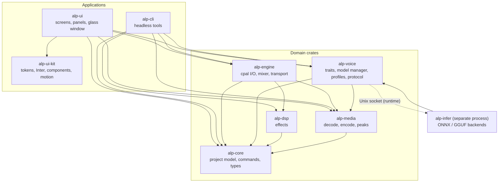

# Audio Lab Pro (ALP) — Agent Build Plan

> Linux-only, English-only, fully-Rust audio studio: multitrack recording/editing/export + local AI TTS, dictation, voice profiles and optional voice cloning.
> Status: **planning**. Items marked **[VERIFY]** came from secondary sources and must be confirmed against primary docs/model cards before relying on them.

---

## 0. Rules for the building agent

1. Work **one phase at a time**. Do not start Phase N+1 until every acceptance criterion of Phase N passes.
2. Record every significant technical choice as an ADR in `docs/adr/NNNN-title.md` (context, options, decision, consequences).
3. Before adding **any** crate or model: record name, version, and license in `THIRD_PARTY.md`. Reject anything whose license conflicts with the app's license (see Open Decisions).
4. Never copy code from Audacity (GPL) or any project whose license is incompatible. Study behavior, not source.
5. `cargo fmt`, `cargo clippy -- -D warnings`, and `cargo test` must pass before every commit. Commit small and often.
6. No telemetry. The only network traffic is **user-initiated model downloads**.
7. Never allocate, lock, or block inside the real-time audio callback.
8. When an Open Decision blocks progress, stop and ask the human instead of guessing.
9. Every phase ends with: updated module docs, an updated architecture diagram (if structure changed), updated `CHANGELOG.md`, a demo script, green guard scripts (file length, dependency directions, module docs), and a short "what's next" note.

### 0.1 Modular code rules (always apply)
1. **Modular by default.** One responsibility per file and per module. Split by responsibility (types / logic / I/O / tests), never arbitrarily.
2. **Hard limit: no source file over 1,500 lines** (code, comments, and inline tests all count). If a file approaches ~1,000 lines, split it proactively. Only files marked `// @generated` are exempt.
3. Keep `mod.rs` / `lib.rs` thin: module declarations and deliberate re-exports only.
4. Move tests into separate files (`tests/` or `*_tests.rs`) once they would push a file past ~600 lines.
5. Prefer small functions (soft limit ~80 lines) and small public APIs; hide internals with `pub(crate)`.
6. Cross-module access goes through public traits/types only. Never reach into another module's internals.
7. Enforce with `scripts/check-file-length.sh`: CI fails above 1,500 lines and warns above 1,000.

### 0.2 Architecture rules
1. The **architecture diagram in Section 3.6 is the source of truth**. In Phase 1, copy it to `docs/architecture/ARCHITECTURE.md` and keep it current.
2. Follow the **allowed dependency directions** in 3.6. A new dependency edge needs an ADR and a diagram update **in the same commit**.
3. `scripts/check-deps.sh` (built on `cargo metadata`) fails CI on forbidden edges.
4. If code and diagram disagree, fix the code or deliberately update the diagram. Never leave drift.

### 0.3 Documentation rules
1. **Every module gets its own doc file** under `docs/modules/`: `docs/modules/<crate>.md`, plus `docs/modules/<crate>/<submodule>.md` for each significant submodule.
2. Required sections: Purpose · Public API · Data flow · Allowed dependencies · Threading / real-time notes · Error handling · Testing · Known limits.
3. Docs change in the **same commit** as the code they describe. Also write `//!` module docs in the source.
4. `scripts/check-docs.sh` fails CI if a crate or top-level module has no doc file.
5. Index everything in `docs/README.md`.

### 0.4 UI rules (apply once D2 = iced is confirmed in Phase 0)
If Phase 0 selects a different toolkit, port these rules to it and record an ADR.
1. **Toolkit:** iced, pinned to an exact version. Upgrades are their own task with an ADR, because iced APIs change between releases **[VERIFY policy]**.
2. **Font:** **Inter** for all UI text. Bundle it with `include_bytes!`, use a small set of static weights (Regular, Medium, SemiBold), and ship the SIL OFL license text in `assets/fonts/` and `THIRD_PARTY.md`. Check tabular-number support for timecodes and meters; if the text stack can't do it, use fixed-width layout cells for numeric readouts **[VERIFY]**.
3. **Components:** every screen uses components from the **`alp-ui-kit`** crate. **No raw `iced::widget::button`** (or any raw widget that has a kit equivalent) in screen code. Enforce with a clippy `disallowed-methods` list in `alp-ui` **[VERIFY]**.
4. **About interior.dev:** it is a React/shadcn-style library that depends on the npm `motion` package, so it **cannot be a dependency** of a Rust/iced app. Use it as a **design and interaction reference** (command palette, dropdown, popover, modal, accordion, loading button, icon morph, tree view, and similar) and re-implement the behaviors in `alp-ui-kit`.
5. **iced component libraries:** evaluate `iced-plus` (design tokens, theme bridge, 30+ components, MIT, early 0.1 release), `iced_aw` (extra widgets), and `iced_ui` in the Phase 0 design-system spike. Adopt one only if it matches the pinned iced version, is maintained, and has a compatible license. Otherwise build in-house. Record the outcome as an ADR (D7).
6. **Buttons:** one `Button` API in `alp-ui-kit` with variants (primary, secondary, ghost, icon, destructive, toggle, loading), states (hover, pressed, focused, disabled), and built-in motion.
7. **Motion across the UI:** one `motion` module in `alp-ui-kit` wraps the chosen animation crate (candidates: `lilt`, a dependency-free library for interruptible, time-based transitions; `iced_anim`, springs and transitions for iced; chosen in Phase 0 as D8). Define motion tokens: durations about 120 / 200 / 320 ms, ease-out by default, spring for panels.
   - **Animate:** hover/press, panel open/close/drag-settle, tab and section changes, dropdowns and popovers, modals and scrims, toasts, list insert/remove, loading states.
   - **Don't animate:** waveform data, meters, or anything that could misrepresent audio. Avoid animating blur radius continuously (expensive); animate opacity and position instead.
   - Request redraws only while an animation is running (no idle CPU burn) and pause when the window is unfocused.
   - Provide a **Reduce motion** setting that disables or shortens animations.
8. **Theme tokens** (color, glass tint, radius, spacing, type scale, motion) live in `alp-ui-kit`. Screens never hard-code values.

---

## 1. Product scope

### In scope
- Multitrack recording, editing, mixing, and export.
- Local TTS: text → audio, built-in voices, voice profiles, voice generation.
- Optional voice cloning via downloadable heavy models.
- Local dictation (speech → text), transcript export.
- Frosted-glass UI with modular floating panels (Motrix 2.0-inspired).
- Linux only (Wayland + X11), English only.

### Out of scope (v1)
- Windows/macOS, non-English UI or models.
- Cloud APIs or accounts.
- Plugin hosting (CLAP/LV2) and MIDI — post-1.0 candidates.
- Video editing.

---

## 2. Decisions

### Locked (from planning discussion)
| Topic | Decision |
|---|---|
| Language | Rust for everything |
| Platform | Linux only |
| Language support | English only |
| Models | Local only; built-in light tier + optional heavy download tier |
| Licensing preference for models | Apache 2.0 (MIT acceptable as equally permissive) |
| UI direction | Motrix 2.0-like, floating panels, frosted-glass backdrop |
| UI toolkit | iced, **pending Phase 0 confirmation** (D2) |
| Code structure | Modular; no source file over 1,500 lines; one doc file per module; architecture diagram followed |
| UI font | Inter |
| UI components | In-house `alp-ui-kit` (interior.dev as design reference only); iced libraries evaluated in Phase 0 |
| UI motion | Motion across the UI through a single `motion` module; honors Reduce motion |

### Open (resolve in Phase 0)
| # | Decision | Notes |
|---|---|---|
| D1 | App license (open source vs paid) | Affects Slint, GPL libs, LAME (LGPL), espeak-ng (GPL) |
| D2 | Confirm UI toolkit: **iced** (target) vs Tauri 2 vs Slint | Phase 0 UI spike; Section 0.4 applies once iced is confirmed |
| D3 | Heavy-model runtime: GGUF via audio.cpp/ggml vs `candle` vs Python sidecar | Decide from the Phase 0 model spike |
| D4 | Internal audio format | Proposed: f32, 48 kHz default, per-project override |
| D5 | Export formats at v1 | Proposed: WAV, FLAC, MP3, OGG Vorbis; Opus later |
| D6 | Dictation model | Proposed: Moonshine (MIT, English); fallback Whisper `.en` (MIT) |
| D7 | Component library: adopt an iced crate vs build in-house | Evaluate `iced-plus`, `iced_aw`, `iced_ui`; interior.dev is React-only |
| D8 | Animation crate: `lilt` vs `iced_anim` | Pick from the Phase 0 motion spike (frame time, idle CPU) |

---

## 3. Architecture

### 3.1 Workspace layout (Cargo workspace)
```
alp/
├─ crates/
│  ├─ alp-core/        # types, project model, commands (undo/redo), serialization
│  ├─ alp-engine/      # real-time audio: cpal I/O, mixer, transport, recorder
│  ├─ alp-media/       # decode (symphonia), encode, resample, peak pyramid, tags
│  ├─ alp-dsp/         # effects: EQ, compressor, limiter, de-esser, denoise, loudness
│  ├─ alp-voice/       # TTS/STT/clone traits, model manager, voice profiles
│  ├─ alp-infer/       # inference worker process (ONNX / GGUF backends)
│  ├─ alp-ui/          # UI app (iced if confirmed): screens, panels, glass window
│  ├─ alp-ui-kit/      # design tokens, Inter font, components (buttons etc.), motion
│  └─ alp-cli/         # headless export/TTS/transcribe for tests and scripting
├─ docs/
│  ├─ README.md                       # docs index
│  ├─ architecture/ARCHITECTURE.md    # diagram + dependency rules (source of truth)
│  ├─ modules/                        # one .md per crate/module: <crate>.md, <crate>/<submodule>.md
│  └─ adr/
├─ scripts/            # check-file-length.sh, check-deps.sh, check-docs.sh
├─ assets/             # icons, fonts (Inter + OFL license), themes, model manifest
├─ THIRD_PARTY.md
└─ ALP_BUILD_PLAN.md
```

### 3.2 Threads and processes
- **UI thread**: rendering and input only.
- **Audio thread** (cpal callback): reads clips from pre-decoded buffers; communicates via lock-free ring buffers (`rtrb` or `ringbuf` [VERIFY choice]).
- **Worker pool**: decode, peak generation, export, effect rendering; every job has a cancellation token and progress channel.
- **Inference worker process** (`alp-infer`): runs TTS/STT/clone models out-of-process so a GPU/VRAM crash or OOM never takes down the editor. Talks to the app over a Unix socket with a small versioned protocol. Also keeps any GPL phonemizer behind a process boundary (get license advice if relevant to D1).

### 3.3 Non-destructive editing model
- Source media is **immutable** and imported into the project's `media/` folder (or referenced).
- A project is a set of **tracks**, each holding **clips**: `{source_id, source_range, timeline_start, gain, fade_in, fade_out, envelope, effects[]}`.
- Edits (cut, trim, split, move, fade) only change clip data. Undo/redo is a **command stack** (every mutation is a `Command` with `apply` / `revert`).
- **Peak pyramid**: min/max peaks at several zoom levels, built once per source and cached in `peaks/`.
- Rendering (playback, bounce, export) walks the clip graph; the same effect code is used for live preview and offline render.

### 3.4 Project format
- Directory-based `*.alp/` with `project.json` (versioned schema + migrations), `media/`, `peaks/`, `renders/`, `voices.ref` (links to voice profiles).
- Atomic saves (write temp, fsync, rename) and autosave with crash recovery.

### 3.5 Voice abstractions (alp-voice)
```rust
trait TtsBackend  { fn id(&self) -> &str; fn voices(&self) -> Vec<VoiceInfo>;
                    fn synthesize(&self, req: TtsRequest) -> Result<PcmStream>; }
trait CloneBackend: TtsBackend { fn create_profile(&self, reference: &Path, transcript: Option<&str>) -> Result<VoiceProfile>;
                                 fn synthesize_with(&self, profile: &VoiceProfile, req: TtsRequest) -> Result<PcmStream>; }
trait SttBackend  { fn transcribe(&self, pcm: PcmChunk) -> Result<Segment>; fn streaming(&self) -> bool; }
```
Backends are registered from the model manifest; the UI only talks to the traits.

### 3.6 Architecture diagram and dependency rules
Initial diagram (copy to `docs/architecture/ARCHITECTURE.md` in Phase 1 and keep it current). Solid arrows are compile-time dependencies; the dotted arrow is the runtime socket connection.



Allowed dependency directions (enforced by `scripts/check-deps.sh`):
- `alp-core` depends on no other ALP crate.
- `alp-media` and `alp-dsp` depend on `alp-core` only.
- `alp-engine` depends on core, media, and dsp. Never on UI or voice.
- `alp-voice` depends on core and media. It reaches `alp-infer` only through the socket protocol at runtime.
- `alp-infer` depends on `alp-voice` (traits and protocol), core, and media.
- `alp-ui-kit` depends on iced only (no ALP crates).
- `alp-ui` depends on ui-kit, core, engine, media, and voice. It never touches cpal or ONNX directly.
- `alp-cli` depends on core, engine, media, dsp, and voice. Never on UI.

---

## 4. Tech stack (proposed)

| Concern | Choice | Notes |
|---|---|---|
| Audio I/O | `cpal` | Used by nearly all Rust audio projects; needs ALSA dev files |
| Decoding | `symphonia` | Decode-only; FLAC/WAV/MP3/AAC/Vorbis/ALAC/AIFF. Opus decode gap reported as of 2026-03 **[VERIFY]** |
| Encoding | `hound` (WAV); FLAC/MP3/OGG encoders **[VERIFY crates + licenses]** | LAME is LGPL |
| Resampling | `rubato` | API changed at 1.0 — pin the version |
| Loudness | `ebur128` | LUFS normalization and metering |
| Denoise | `nnnoiseless` (RNNoise port) | Speech-oriented; build a classical-DSP fallback |
| DSP blocks | `fundsp`, own biquads | EQ, compressor, limiter, de-esser |
| FFT/spectrogram | `rustfft` / `realfft` **[VERIFY]** | |
| ONNX inference | `ort` | Kokoro, Kitten, Moonshine |
| Heavy models | see D3 | audio.cpp/GGUF route runs Qwen3-TTS, VoxCPM2, OmniVoice, Kokoro **[VERIFY]** |
| UI | per D2 (iced target) | wgpu rendering; custom waveform widget |
| UI font | **Inter** (SIL OFL) | Bundled static weights; license text in `THIRD_PARTY.md` |
| UI components | `alp-ui-kit` (in-house); candidates to evaluate: `iced-plus`, `iced_aw`, `iced_ui` | interior.dev is React-only: design reference, not a dependency (D7) |
| Motion | `lilt` or `iced_anim` (D8) | Wrapped by `alp-ui-kit::motion` |
| Window blur | `ext-background-effect-v1`, KDE blur protocol, X11 property | Needs raw window handle access **[VERIFY in iced]** |
| Serialization | `serde`, `serde_json` | |
| Async/jobs | `tokio` or `rayon` + channels | Keep the audio thread free of both |

---

## 5. Model strategy

### 5.1 Built-in (ships with installer or first-run) — English, lightweight
| Role | Model | License | Approx. size | Notes |
|---|---|---|---|---|
| Instant-start TTS | **KittenTTS nano** | Apache 2.0 | ~25–80 MB | 8 voices, English, no cloning |
| Main TTS | **Kokoro-82M** | Apache 2.0 | ~310 MB ONNX (fp32 conversion) | Fast on CPU, many fixed voices; no cloning |
| Dictation | **Moonshine tiny/base** | MIT (English models) | ~27M / 62M params | English-only; streaming-friendly |

### 5.2 Optional downloads (cloning + voice design) — Apache 2.0
| Model | License | Approx. size | Capability |
|---|---|---|---|
| **Qwen3-TTS 0.6B Base** ("Fast") | Apache 2.0 | ~2 GB (Q8 GGUF) | ~3 s reference cloning; ~4 GB VRAM class |
| **Qwen3-TTS 1.7B Base** ("Best") | Apache 2.0 | ~2.7 GB (Q8 GGUF) | Higher quality cloning; ~8 GB VRAM class |
| **VoxCPM2** | Apache 2.0 | **[VERIFY]** | Voice design from text description + controllable cloning |
| **OmniVoice** | Apache 2.0 | **[VERIFY]** | ~3–10 s reference cloning; Qwen3-0.6B backbone |

### 5.3 Do NOT use
- **F5-TTS** weights (CC-BY-NC), **XTTS-v2** (Coqui CPML), **KittenTTS 2** (Stellon Labs Community License + external AUP).

### 5.4 License verification checklist (per model, before shipping)
- [ ] Read the license on the **model card** (not just the repo/blog).
- [ ] Confirm weights license is separate from code license.
- [ ] Confirm any acceptable-use policy and attribution requirements.
- [ ] Confirm redistribution rules (ship vs. download-only).
- [ ] Record in `THIRD_PARTY.md` and in the model manifest (`license`, `license_url`).

### 5.5 Model manifest (assets/models.json)
Fields: `id`, `name`, `role` (tts|stt|clone|design), `tier` (builtin|download), `version`, `files[] {url, sha256, size}`, `license`, `license_url`, `min_ram_gb`, `min_vram_gb`, `backend`, `languages`, `notes`.

---

## 6. Phases

> Targets below are **initial** and should be tuned after the Phase 0 spikes.

### Phase 0 — Research spikes and decisions (≈1–2 weeks)
**Goal:** replace assumptions with evidence; close D1–D6.

Tasks
- **UI spike:** one frosted-glass floating panel + a live scrolling waveform in **iced** and in **Tauri 2**. Test on KDE Plasma (Wayland), GNOME (Wayland), an X11 session, and one NVIDIA machine.
- **Blur spike:** request blur through `ext-background-effect-v1`, the KDE protocol, and the X11 property; confirm the toolkit exposes the raw window handle. Build the **no-blur fallback** (translucent panel + in-app shader blur).
- **Floating-panel spike:** draw panels inside one transparent window (not separate OS windows); drag, resize, dock, snap.
- **Audio spike:** cpal record + playback with a ring buffer; measure xruns and latency; decode a 1-hour file with symphonia and build a peak pyramid.
- **Model spike A (light):** run Kitten nano and Kokoro through `ort` from Rust; check phonemization needs (e.g. espeak-ng, GPL) and alternatives; run Moonshine via ONNX.
- **Model spike B (heavy):** try Qwen3-TTS via GGUF/ggml from Rust (FFI) vs `candle` vs Python sidecar; record VRAM/RAM/speed.
- **License pass:** complete the 5.4 checklist for every model; list GPL/LGPL dependencies and decide D1.
- **Design-system spike:** with Inter loaded, build a primary/ghost/icon/loading button set, a dropdown, a modal, a toast, and a command palette in `alp-ui-kit`. Try `iced-plus`, `iced_aw`, and `iced_ui` for comparison (iced-version match, maintenance, license). Decide D7.
- **Motion spike:** prototype panel open/close, hover/press, and a toast with `lilt` and `iced_anim`. Measure frame time and idle CPU, and implement a Reduce-motion switch. Decide D8.
- **Architecture pass:** draft `docs/architecture/ARCHITECTURE.md` from Section 3.6 and adjust it to the spike results.

Deliverables: ADRs for D1–D8, spike repos/branches, a comparison table, updated stack section, initial architecture doc.

Acceptance
- A working demo of the chosen UI toolkit showing glass + waveform on ≥2 desktops, with the fallback verified.
- Kokoro (or Kitten) speaks a sentence from Rust; Moonshine transcribes a clip.
- One heavy-model path proven end-to-end (even if slow).
- D1–D8 decided or explicitly deferred with reasons.
- Component and motion approach chosen with measured frame-time and idle-CPU numbers.

### Phase 1 — Foundation (≈2 weeks)
**Goal:** workspace, engine core, project model.

Tasks
- Create the Cargo workspace and CI (fmt, clippy, test, build) plus the three guard scripts: `check-file-length.sh` (≤1,500 lines per file), `check-deps.sh` (dependency directions from 3.6), and `check-docs.sh` (every module has a doc file). Add `THIRD_PARTY.md` and `CHANGELOG.md`.
- Create `docs/README.md`, `docs/architecture/ARCHITECTURE.md` (from Section 3.6), and a doc stub in `docs/modules/` for every crate using the required template.
- `alp-core`: project/track/clip types, command stack (undo/redo), JSON schema with version + migration scaffold.
- `alp-media`: decode with symphonia, resample with rubato, WAV writer, peak-pyramid builder + disk cache.
- `alp-engine`: cpal output/input, transport (play/pause/seek/loop), lock-free command channel, simple mixer.
- `alp-cli`: `alp-cli decode`, `alp-cli peaks`, `alp-cli render` for headless testing.
- Logging (`tracing`), error types, config in XDG dirs.

Acceptance
- Open a 1-hour WAV headlessly; peaks built and cached; reopening is near-instant.
- Play 8 simultaneous clips with no xruns for 10 minutes on the reference machine.
- Undo/redo property tests pass (apply → revert returns identical project state).
- CI is green with all three guard scripts; every crate has a module doc, and the diagram matches `cargo metadata`.

### Phase 2 — UI shell and glass system (≈2–3 weeks)
**Goal:** the look and the panel framework, before features pile on.

Tasks
- Main window (transparent), compositor blur negotiation, runtime detection, and fallback.
- Create `alp-ui-kit`: design tokens (color, glass tint, blur strength, radius, spacing, type scale, motion), runtime dark/light switching, saved in config.
- Bundle **Inter** and make it the default font everywhere.
- Build the component set in `alp-ui-kit`: Button (all variants and states, with motion), IconButton, Toggle, Slider, Dropdown, Popover, Modal, Toast, Tabs, Tooltip, Command palette. Document each in `docs/modules/alp-ui-kit/`.
- Build the `motion` module: tokens, Reduce-motion setting, animated panel open/close/drag-settle.
- **Panel manager:** floating panels with drag, resize, z-order, snap-to-edge, collapse, dock/undock, layout save/restore.
- Core panels as stubs: Transport, Tracks/Timeline, Inspector, Media Bin, Voice Lab, Effects, Models, Export queue.
- Custom GPU **waveform widget** using the peak pyramid (smooth zoom/scroll).
- Keyboard shortcuts, command palette, accessibility basics (focus order, contrast, scalable text).

Acceptance
- Glass works on KDE and GNOME (where the protocol is available); a clean fallback elsewhere.
- Panels persist layout across restarts; 60 fps scrolling on a 1-hour waveform on the reference machine.
- UI never blocks while workers run (long-running jobs show progress and are cancellable).
- No raw `iced::widget::button` in `alp-ui` (lint passes); all text renders in Inter; Reduce motion works; idle CPU stays near zero when nothing is animating.

### Phase 3 — Recording and single-track editing (≈3 weeks)
**Goal:** a complete, trustworthy recorder/editor for one track.

Tasks
- Device picker, input metering (peak/RMS), monitoring, record to disk with crash-safe chunking.
- Selection model (range, cursor, snap), cut/copy/paste/delete/silence/trim/split/duplicate.
- Fades, gain, normalize, reverse, invert; clip envelope (volume automation) basics.
- Punch-in / re-record over a selection.
- Import (drag & drop) with background decode; format conversion on import when needed.
- Export WAV and FLAC (bit depth, sample rate, dither); metadata tags.

Acceptance
- Record 30 min with zero dropouts; project survives a forced kill (autosave recovery).
- All edits undoable; export of an edited file matches the in-app playback (null test).

### Phase 4 — Multitrack timeline and mixing (≈3–4 weeks)
**Goal:** Audacity-class multitrack workflow.

Tasks
- Add/remove/reorder tracks; mute/solo/arm; per-track gain/pan; track colors and names.
- Clip drag/move across tracks, snapping, ripple options, split, crossfades, per-clip fades.
- Multi-track recording (arm several inputs where hardware allows) and overdub.
- Markers, regions, loop range, ruler (time/bars optional), zoom/scroll, minimap.
- Mixer panel with meters; master bus with limiter.
- **Bounce/mixdown export:** WAV, FLAC, MP3, OGG Vorbis **[VERIFY encoders/licenses]**; stems export; export presets (podcast, audiobook, voice-over).
- Spectrogram view (optional toggle).

Acceptance
- A 10-track, 30-minute project plays and scrubs smoothly; mixdown matches a reference render within an agreed null-test threshold.
- Stem export and master export produce correct channel layouts and tags.

### Phase 5 — Effects and voice cleanup (≈3 weeks)  → **Release v0.1 "Editor"**
**Goal:** the tools voice-over work actually needs.

Tasks
- One `Effect` trait used for live preview and offline render; parameter smoothing; presets.
- EQ (parametric + high-pass), compressor, limiter, gate, de-esser, de-click, de-hum.
- **Noise reduction:** RNNoise (`nnnoiseless`) path + classical spectral fallback; noise-profile capture.
- **Loudness:** LUFS measure + normalize to target (e.g. -16 LUFS podcast, other presets), true-peak limiting.
- **Silence/breath tools:** auto-trim silence, shorten pauses, breath reduction.
- Effect chains per track/clip; "Voice Cleanup" one-click chain.
- Effects panel with A/B compare and undo.

Acceptance
- Cleanup chain improves a noisy test set measurably (documented before/after metrics) without audible artifacts on clean speech.
- Offline render equals live preview (null test within threshold).
- **v0.1 release checklist** (Section 9) passes.

### Phase 6 — Model manager and built-in TTS (≈3 weeks)
**Goal:** text → audio with the lightweight tier, plus the download system.

Tasks
- **Model manager:** manifest-driven catalogue, resumable downloads, SHA-256 verification, disk-space check, per-model license screen + accept, update/remove, offline mode, storage in XDG data dir.
- `alp-infer` worker process + socket protocol; health checks, restart-on-crash, progress/cancel.
- Backends: **Kitten nano** and **Kokoro-82M** via ONNX (`ort`); text normalization (numbers, currency, abbreviations), phonemization (per spike decision).
- **Voice Lab panel:** voice list with preview, speed/pitch-style controls the model supports, text editor, **Generate → clip on a chosen track/timeline position**.
- Long-text handling: sentence/paragraph chunking, gapless stitching, per-paragraph regenerate, progress and cancel.
- Pronunciation dictionary (word → phonemes/respelling); simple pause/emphasis markup (keep it minimal and documented).
- **Script mode:** a script split into lines/paragraphs, each generating its own clip; re-generate one line without redoing the rest.
- Batch export: script → one audio file or one file per line.

Acceptance
- First audio for a ~20-word sentence in under ~2 s on a mid-range CPU (initial target) using the light tier.
- Fresh install: app works with the built-in model offline; Kokoro downloads with resume and checksum verification.
- A 5,000-word script renders to a timeline without UI freezes, and any single paragraph can be regenerated.

### Phase 7 — Dictation and transcription (≈2 weeks)
**Goal:** speech → text, in-app and system-friendly.

Tasks
- Voice activity detection (VAD) to segment speech; choose a permissively licensed VAD **[VERIFY]**.
- `SttBackend` with Moonshine (ONNX); Whisper `.en` as optional alternative per D6.
- **Dictation mode:** push-to-talk/toggle hotkey, live partial results, insert into the Voice Lab script editor or a transcript panel.
- **Transcribe clip/track:** timestamps per segment; click-to-seek; edit transcript.
- Export: TXT, SRT, VTT; optional "text-based editing" (delete words → cut audio) as a stretch goal.
- Clipboard/typing-injection options for system-wide dictation **only if** feasible under Wayland **[VERIFY]**; otherwise in-app only.

Acceptance
- Live dictation with sub-second perceived latency on CPU for short utterances (initial target).
- Transcript timestamps align with audio within an agreed tolerance on a test set.

### Phase 8 — Voice profiles, cloning, and voice generation (≈4 weeks)  → **Release v0.2 "Voice" then v0.3 "Clone"**
**Goal:** reusable voices, optional cloning, and designed voices.

Tasks
- **Voice profile system:** a library independent of projects (`~/.local/share/.../voices/`), each profile = `{id, name, type: builtin|cloned|designed, backend, reference audio, transcript, cached embedding, tags, default params, created_at, consent_record}`; import/export as `.alpvoice` (zip).
- **Prebuilt profiles:** wrap built-in Kitten/Kokoro voices as profiles with friendly names, tags, and sample previews.
- **Hardware detection:** RAM/VRAM/CPU/GPU probe; recommend "Fast" vs "Best" model; clear warnings before big downloads.
- **Clone backends (optional downloads):** Qwen3-TTS 0.6B/1.7B, VoxCPM2, OmniVoice behind `CloneBackend`, using the runtime chosen in D3 (isolated in `alp-infer`).
- **Reference capture/import:** record or import a clip; quality checks (length, clipping, noise, silence, sample rate) with actionable advice; optional auto-clean using Phase 5 tools; optional transcript for "continuation-style" cloning where the model supports it.
- **Voice design:** create a voice from a text description where supported (e.g. VoxCPM2), then save it as a profile.
- **Generation controls:** per-profile style/speed/emotion controls exposed only where the backend supports them (capability flags drive the UI).
- **Consent and safety:** a clear consent gate before creating a clone (attestation that the user has the speaker's permission), stored in the profile; no bundled voices of real people; an optional "synthetic voice" metadata tag on exports (on by default); documented acceptable-use note.
- **Compare tool:** A/B a reference vs generated line; side-by-side profile preview.
- Cache generated audio by `(profile, text, params)` to avoid regenerating identical lines.

Acceptance
- Create a profile from a ≥5 s reference, generate a paragraph, and place it on the timeline, entirely offline after the model download.
- Backends can be installed/removed independently; the app stays fully usable without any heavy model.
- A crash or OOM in a heavy model never crashes the editor; the user sees a recoverable error.
- Consent record is stored and visible; export metadata tag works.

### Phase 9 — Polish, packaging, and 1.0 (≈3 weeks)
**Goal:** something people can install and trust.

Tasks
- Performance pass: startup time, memory, peak-cache sizes, large-project stress tests.
- Reliability: crash recovery, corrupted-project handling, fuzzing the project loader and importers.
- Packaging: AppImage and Flatpak first; `.deb`/`.rpm` as follow-ups; desktop file, icons, MIME types for `.alp`.
- Accessibility and usability pass; first-run wizard (device setup, model selection, glass preview/fallback).
- Documentation: user guide, keyboard shortcuts, voice-cloning ethics note, troubleshooting (Wayland/NVIDIA/ALSA/PipeWire).
- Final license audit and `THIRD_PARTY.md` completeness; reproducible release builds.

Acceptance
- **v1.0 release checklist** (Section 9) passes on a clean machine for each supported packaging format.

### Post-1.0 backlog
CLAP/LV2 plugin hosting; time-stretch/pitch (check license: Rubber Band is GPL; Signalsmith Stretch is MIT — **[VERIFY]**); spectral editing; macros/batch processing; text-based audio editing; MIDI; additional export codecs (Opus/AAC); optional Python-free multi-voice dialogue tools.

---

## 7. Testing strategy
- **Unit/property tests:** command stack (apply/revert), clip math, peak pyramid correctness.
- **Golden audio tests:** render fixtures through the CLI and compare using null tests/spectral distance; store small fixtures in-repo.
- **Headless engine tests:** run `alp-cli` in CI with no audio device.
- **Real-time safety checks:** assert no allocations/locks in the callback (debug allocator guard or `assert_no_alloc`-style checks **[VERIFY]**).
- **Soak tests:** long recordings and long playback on the reference machine.
- **Model tests:** each backend has a smoke test (short phrase → non-silent audio of plausible duration), plus checksum and manifest validation.
- **Cross-desktop manual matrix:** KDE Wayland, GNOME Wayland, X11, NVIDIA; PipeWire and ALSA.

## 8. Performance and quality budgets (initial)
| Area | Target |
|---|---|
| UI scroll/zoom | 60 fps on a 1-hour waveform |
| Audio callback | No xruns in 10-minute 8-clip playback on reference machine |
| Open cached project | < 2 s for a 30-minute, 10-track project |
| Light TTS first audio | < ~2 s for a 20-word sentence (CPU) |
| Dictation latency | Sub-second for short utterances (CPU) |
| Installer (without heavy models) | Keep as small as practical; light models can be first-run downloads |

## 9. Release milestones
| Release | After phase | Contents |
|---|---|---|
| **v0.1 "Editor"** | 5 | Record, multitrack edit, mix, effects, export |
| **v0.2 "Voice"** | 6–7 | Built-in TTS, script mode, dictation, model manager |
| **v0.3 "Clone"** | 8 | Voice profiles, optional cloning/design backends |
| **v1.0** | 9 | Polished, packaged, documented |

Per-release checklist: all acceptance criteria met · guard scripts green (file length, dependency directions, module docs) · cross-desktop matrix run · `THIRD_PARTY.md` audited · model licenses re-verified · changelog · packaged builds smoke-tested.

## 10. Risk register
| Risk | Impact | Mitigation |
|---|---|---|
| Window blur missing or inconsistent across compositors | Look degrades | Runtime detection + good fallback; treat glass as progressive enhancement |
| Toolkit doesn't expose raw window handle | Can't request blur | Phase 0 spike; own winit shell or alternate toolkit |
| Tauri/WebKitGTK rendering bugs (NVIDIA) if Tauri is chosen | Blank/flickering windows | Prefer native toolkit; test early; documented workarounds |
| Heavy models too slow/large in Rust | Cloning unusable | Out-of-process sidecar; offer 0.6B tier; allow CPU-slow mode with clear warnings |
| License surprises (GPL phonemizer, LGPL encoder, NC weights) | Distribution blocked | Phase 0 license pass; process isolation; per-model checklist |
| Real-time glitches under load | Bad recording experience | Lock-free design, soak tests, buffer-size settings |
| Scope creep toward a full DAW | Never ships | Hold the Phase boundaries; backlog everything else |
| iced component crates immature or out of step with the pinned iced version | Blocked UI work | Build `alp-ui-kit` in-house; adopt external crates only after the Phase 0 evaluation |
| Animation causes jank or idle CPU use | Poor UX, battery drain | Redraw only while animating; no blur-radius animation; frame-time tests; Reduce-motion setting |
| Files and modules grow into monoliths | Hard to maintain, agent mistakes | 1,500-line CI gate, early splits, per-module docs, dependency check |
| Voice cloning misuse | Ethical/legal exposure | Consent gate, metadata tag, no celebrity voices, clear usage note |

## 11. Phase handoff template (agent fills at the end of each phase)
```
Phase N — summary
- Completed: …
- Acceptance results: (criterion → pass/fail + evidence)
- Guard checks: file length / dependency directions / module docs (pass/fail)
- Docs updated: modules touched and any architecture-diagram changes
- Deviations from plan and ADRs written: …
- Known issues / tech debt: …
- Open decisions needing the human: …
- Proposed adjustments to the next phase: …
```
