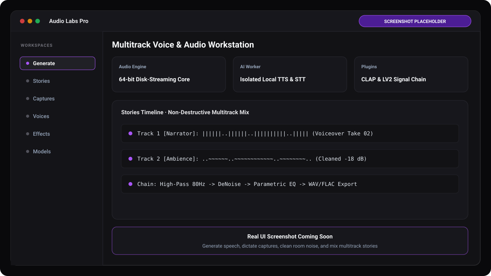
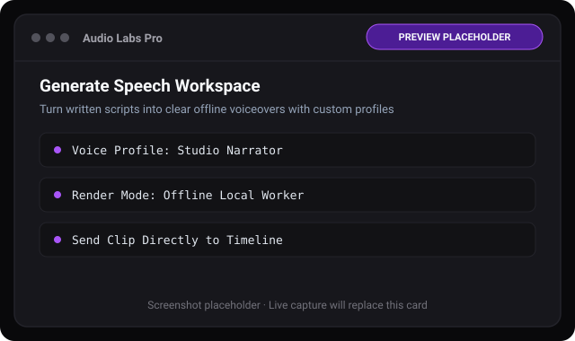
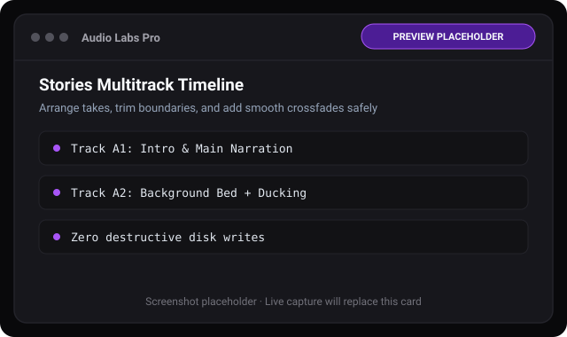
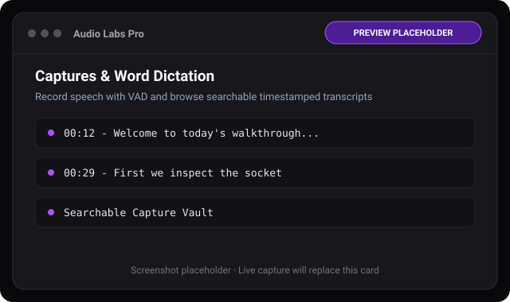
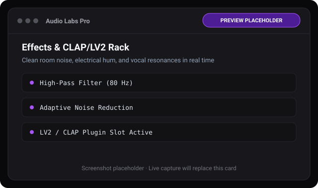
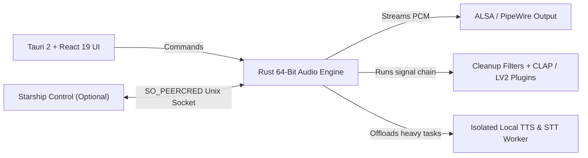

<div align="center">
  <a id="top"></a>
  <p>
    
  </p>

  <h1>Audio Labs Pro</h1>

  <h3>Offline-first voice studio and multitrack audio workstation for Linux</h3>

  <p>
    Generate local voiceovers, transcribe spoken takes, clean background noise, and mix multitrack audio without cloud subscriptions.
  </p>

  <p>
    <a href="https://zvirox.in/projects/alp/">Project Page</a> ·
    <a href="https://zvirox.in/downloads/alp/">Download Packages</a> ·
    <a href="https://github.com/zvirox/audio-labs-pro/releases">GitHub Releases</a> ·
    <a href="#quick-installation">Quick Install</a> ·
    <a href="#key-features">Features</a> ·
    <a href="#starship-control-integration">Starship Control</a> ·
    <a href="#maintainer-and-ecosystem">Maintainer</a> ·
    <a href="#frequently-asked-questions">FAQ</a>
  </p>

  <p>
    <a href="https://zvirox.in/downloads/alp/">
      
    </a>
    <a href="https://github.com/zvirox/audio-labs-pro/actions/workflows/ci.yml">
      
    </a>
    <a href="LICENSE">
      
    </a>
    
    
  </p>

  <table>
    <tr>
      <td align="right"><b>Start</b></td>
      <td align="center"><a href="#what-is-audio-labs-pro">What It Is</a></td>
      <td align="center"><a href="#workspace-previews">Previews</a></td>
      <td align="center"><a href="#quick-installation">Install</a></td>
    </tr>
    <tr>
      <td align="right"><b>Features</b></td>
      <td align="center"><a href="#key-features">Key Capabilities</a></td>
      <td align="center"><a href="#how-the-audio-engine-works">Audio Engine</a></td>
      <td align="center"><a href="#tech-stack">Tech Stack</a></td>
    </tr>
    <tr>
      <td align="right"><b>Automation</b></td>
      <td align="center"><a href="#starship-control-integration">Starship Control</a></td>
      <td align="center"><a href="#real-world-use-cases">Use Cases</a></td>
      <td align="center"><a href="#how-connection-works">Socket Setup</a></td>
    </tr>
    <tr>
      <td align="right"><b>Community</b></td>
      <td align="center"><a href="#frequently-asked-questions">FAQ</a></td>
      <td align="center"><a href="#maintainer-and-ecosystem">Maintainer</a></td>
      <td align="center"><a href="#license">License</a></td>
    </tr>
  </table>
</div>

<br />

<p align="center">
  
  <br />
  <sub><b>Screenshot placeholder.</b> Audio Labs Pro Stories workspace with multitrack waveforms and isolated voice processing.</sub>
</p>

---

## What is Audio Labs Pro?

Recording narration, cleaning noisy room takes, and combining multiple voice tracks often requires jumping between paid cloud websites and complicated studio software. Uploading private interviews or unreleased voice samples to remote servers creates unwanted privacy risks.

Audio Labs Pro gives Linux creators an offline-by-default voice studio and multitrack audio workstation. Seven focused views let you record microphone takes, dictate searchable notes, synthesize speech from scripts locally, strip background hum, host CLAP and LV2 plugins, and mix multitrack stories with zero internet required.

Heavy speech generation and transcription run inside a separate local worker process so your live playback never stutters.

---

## Workspace Previews

<table>
  <tr>
    <td width="50%" valign="top">
      <br />
      <strong>Generate Speech Studio</strong><br />
      Turn written paragraphs into clear voiceovers on your own device using saved voice profiles and offline models.
    </td>
    <td width="50%" valign="top">
      <br />
      <strong>Stories Multitrack Timeline</strong><br />
      Cut, trim, crossfade, and arrange voice takes on multiple tracks while keeping original recordings untouched on disk.
    </td>
  </tr>
  <tr>
    <td width="50%" valign="top">
      <br />
      <strong>Captures and Dictation</strong><br />
      Record quick thoughts with automatic voice detection and browse word-accurate local transcripts.
    </td>
    <td width="50%" valign="top">
      <br />
      <strong>Effects and Plugin Chain</strong><br />
      Clean air-conditioner hum, reduce room noise, shape tone with parametric EQ, and load CLAP or LV2 audio plugins.
    </td>
  </tr>
</table>

---

## Key Features

- **Seven Organized Workspaces**: Move smoothly between **Generate** (speech synthesis), **Stories** (multitrack narration), **Captures** (mic recording and dictation), **Voices** (profile manager), **Effects** (signal cleanup), **Models** (local downloads), and **Settings**.
- **64-Bit Disk-Streaming Engine**: Record and mix multi-hour interviews or podcast sessions smoothly without loading everything into memory.
- **Non-Destructive Timeline**: Every slice, volume envelope, and crossfade stays reversible while your raw WAV or FLAC takes remain safe on disk.
- **Offline Speech Synthesis and Dictation**: Generate spoken lines and transcribe audio locally with private models running in an isolated child process.
- **CLAP and LV2 Plugin Support**: Bring your own open Linux audio effects straight into the track signal chain.
- **Lossless Export Options**: Save finished audio as uncompressed WAV or lossless FLAC at your chosen sample rate and bit depth.

---

## How the Audio Engine Works

Audio Labs Pro isolates real-time audio playback from heavy AI calculations so sliders and meters stay responsive under load.



| Workspace | What It Handles | Offline Ready? |
| :--- | :--- | :---: |
| **Generate** | Local text-to-speech generation queue | Yes |
| **Stories** | Multitrack clip arrangement, fades, and timing | Yes |
| **Captures** | Microphone takes, VAD trigger, and local transcripts | Yes |
| **Voices** | Custom local voice profiles and settings | Yes |
| **Effects** | High-pass filter, DeNoise, parametric EQ, CLAP / LV2 | Yes |
| **Models** | Local speech model storage and downloads | Yes (after download) |

---

## Starship Control Integration

Audio Labs Pro functions as a complete standalone workstation. You do not need any companion software to record, clean, mix, and export audio.

If you want hands-free assistance across apps, Audio Labs Pro connects directly with [Starship Control](https://github.com/zvirox/starship-control) ([Releases](https://github.com/zvirox/starship-control/releases)), the optional Linux desktop AI assistant.

### Why It Exists

Cleaning background hums, trimming long pauses, and laying dozens of narration clips onto tracks involves repetitive clicking. Connecting Audio Labs Pro to Starship Control lets you describe the audio work you want done in simple sentences while you keep creative control.

### Real-World Use Cases

- **Instant Noise Cleanup**: Ask Starship Control *"Check track 1 for low room hum and apply a clean high-pass filter."*
- **Script to Multitrack Narration**: Tell the assistant *"Read this script with my narrator profile and place the generated lines on track 1 with 2-second gaps."*
- **Cross-App Media Finishing**: Ask *"Grab the audio from my newest Screen Studio Pro clip, clean the voice in Audio Labs Pro, and export a WAV take."*

### How Connection Works

Setup happens automatically in the background:

1. **Local Discovery**: Audio Labs Pro writes a small plugin descriptor to `$XDG_DATA_HOME/starship/plugins/alp.json` on startup.
2. **Private Unix Socket**: Commands flow over `$XDG_RUNTIME_DIR/starship/bridges/alp.sock`.
3. **Kernel User Verification**: Connections check Linux `SO_PEERCRED` credentials so only programs running under your exact user account can access your audio workspace. Zero web ports open.
4. **Immediate Access**: Summon Starship Control with `Super+Shift+Space` to send voice or text instructions immediately. For setup guides and downloads, visit the [Starship Control repository](https://github.com/zvirox/starship-control) and [releases](https://github.com/zvirox/starship-control/releases).

---

## Quick Installation

Prebuilt Linux packages and checksum files are published on the [Releases page](https://github.com/zvirox/audio-labs-pro/releases).

| Distribution | Package Format | Install Command |
| :--- | :--- | :--- |
| **Debian / Ubuntu / Pop!_OS / Mint** | `.deb` | `sudo apt install ./audio-labs-pro_*_amd64.deb` |
| **Fedora / RHEL / openSUSE** | `.rpm` | `sudo dnf install ./audio-labs-pro-*.x86_64.rpm` |
| **Arch Linux / Manjaro / CachyOS** | `.pkg.tar.zst` | `sudo pacman -U ./audio-labs-pro-*-x86_64.pkg.tar.zst` |

<details>
<summary><strong>Verify Checksums and Build From Source</strong></summary>

Verify downloaded files using `SHA256SUMS`:

```bash
sha256sum -c SHA256SUMS --ignore-missing
```

To build from source, install Rust stable, Node.js 22+, and Linux audio/desktop libraries (`libasound2-dev`, `libwebkit2gtk-4.1-dev`, `libgtk-3-dev`, `pkg-config`):

```bash
git clone https://github.com/zvirox/audio-labs-pro.git
cd audio-labs-pro
npm --prefix frontend install && npm --prefix frontend run build
cargo build --release -p alp-desktop
```

</details>

Official Linux releases ship exclusively as native `.deb`, `.rpm`, and `.pkg.tar.zst` packages alongside `SHA256SUMS`. Legacy AppImage, Flatpak, tarball, and AUR packages are retired and no longer updated.

---

## Tech Stack

| Layer | Technology | Role |
| :--- | :--- | :--- |
| **Audio Core** | Rust 2024 Workspace | 64-bit mixing, streaming I/O, and DSP cleanup effects |
| **Plugin Hosting** | CLAP & LV2 | External open audio effect integration |
| **Desktop Shell** | Tauri 2 | Native Linux windowing and file system integration |
| **Frontend UI** | React 19 + TypeScript + Tailwind CSS v4 | Matte dark multitrack timeline and voice studio controls |
| **Visuals & State** | Apache ECharts 6 + Zustand | Metering graphs and reactive studio state |
| **Automation Bridge** | `alp-mcp` + `starship-plugin` | Local socket tools for Starship Control |

---

## Frequently Asked Questions

**Does Audio Labs Pro work offline?**
Yes. Speech generation, dictation, audio cleanup, and multitrack mixing run completely locally once you install the app and any chosen voice models.

**Is Starship Control required to edit audio?**
No. Audio Labs Pro works completely standalone with its own visual interface and keyboard shortcuts. Starship Control is an optional add-on for automated cross-app tasks.

**Can it handle long multi-hour interviews?**
Yes. The audio core streams directly from disk instead of loading whole recordings into RAM, keeping long sessions steady and responsive.

**Are my voice profiles kept private?**
Yes. Voice samples, profiles, and synthesized clips live solely in your local directory and never leave your machine.

---

## Maintainer and Ecosystem

<p align="center">
  <a href="https://www.zvirox.in">
    
  </a>
</p>

<p align="center">
  <strong>Prakashpuri Gauswami (<a href="https://github.com/zvirox">@zvirox</a>)</strong><br />
  Cybersecurity Analyst &amp; SOC Practitioner · Agentic AI Builder · Blue Team &amp; SIEM · Patan, Gujarat, India
</p>

<p align="center">
  <a href="https://github.com/sponsors/zvirox">
    
  </a>
  <a href="https://ko-fi.com/zvirox">
    
  </a>
</p>

I build local-first open-source Linux and Android tools under **Zvirox**. Writing real software helps me study system boundaries and security architecture hands-on while giving creators and Linux users fast desktop tools free from subscriptions and telemetry.

### Connect and Support

- **GitHub Profile**: [github.com/zvirox](https://github.com/zvirox)
- **Website**: [www.zvirox.in](https://www.zvirox.in)
- **Email**: [info@zvirox.in](mailto:info@zvirox.in)
- **Sponsor**: [GitHub Sponsors](https://github.com/sponsors/zvirox) · [Ko-fi](https://ko-fi.com/zvirox)
- **Socials**: [LinkedIn (`in/plgsevala`)](https://www.linkedin.com/in/plgsevala) · [YouTube (`@zvirox_in`)](https://www.youtube.com/@zvirox_in) · [Instagram (`plg.sevala`)](https://www.instagram.com/plg.sevala) · [Facebook (`plg.sevala`)](https://www.facebook.com/plg.sevala)

### Zvirox App Suite (Open-Source Project List)

All six applications in the Zvirox desktop suite work standalone and connect together through Starship Control:

| Logo | Application | Purpose | Repository | Download & Project |
| :---: | :--- | :--- | :--- | :--- |
|  | **[Starship Control](https://zvirox.in/projects/sc/)** | Local-first AI desktop cockpit and floating HUD | [github.com/zvirox/starship-control](https://github.com/zvirox/starship-control) | [Download](https://zvirox.in/downloads/sc/) · [Releases](https://github.com/zvirox/starship-control/releases) |
|  | **[Screen Studio Pro](https://zvirox.in/projects/ssp/)** | Wayland and X11 screen recorder with PipeWire | [github.com/zvirox/screen-studio-pro](https://github.com/zvirox/screen-studio-pro) | [Download](https://zvirox.in/downloads/ssp/) · [Releases](https://github.com/zvirox/screen-studio-pro/releases) |
|  | **[Easy Edits Pro](https://zvirox.in/projects/eep/)** | Non-destructive multitrack video editor | [github.com/zvirox/easy-edits-pro](https://github.com/zvirox/easy-edits-pro) | [Download](https://zvirox.in/downloads/eep/) · [Releases](https://github.com/zvirox/easy-edits-pro/releases) |
|  | **[Audio Labs Pro](https://zvirox.in/projects/alp/)** | Offline voice studio and multitrack audio editor | [github.com/zvirox/audio-labs-pro](https://github.com/zvirox/audio-labs-pro) | [Download](https://zvirox.in/downloads/alp/) · [Releases](https://github.com/zvirox/audio-labs-pro/releases) |
|  | **[Agentic Tuneup Pro](https://zvirox.in/projects/atp/)** | Safety-first disk cleaner and system optimizer | [github.com/zvirox/agentic-tuneup-pro](https://github.com/zvirox/agentic-tuneup-pro) | [Download](https://zvirox.in/downloads/atp/) · [Releases](https://github.com/zvirox/agentic-tuneup-pro/releases) |
|  | **[Net Watch Pro](https://zvirox.in/projects/nwp/)** | Real-time network speed and per-app data tracker | [github.com/zvirox/net-watch-pro](https://github.com/zvirox/net-watch-pro) | [Download](https://zvirox.in/downloads/nwp/) · [Releases](https://github.com/zvirox/net-watch-pro/releases) |
| - | **[Your TV Friend](https://zvirox.in/projects/ytf/)** | Android TV non-destructive debloater and Your UI launcher | [github.com/zvirox/your-tv-friend](https://github.com/zvirox/your-tv-friend) | [Download APK](https://zvirox.in/downloads/ytf/) · [Releases](https://github.com/zvirox/your-tv-friend/releases) |

---

## Star History

<p align="center">
  <a href="https://www.star-history.com/#zvirox/audio-labs-pro&Date">
    <picture>
      <source media="(prefers-color-scheme: dark)" srcset="https://api.star-history.com/svg?repos=zvirox/audio-labs-pro&type=Date&theme=dark" />
      <source media="(prefers-color-scheme: light)" srcset="https://api.star-history.com/svg?repos=zvirox/audio-labs-pro&type=Date" />
      
    </picture>
  </a>
</p>

---

## License

Audio Labs Pro is free, open-source software licensed under the [Apache License, Version 2.0](LICENSE).

<div align="center">
  <br />
  <a href="#top"><strong>Back to top</strong></a> · Built in public by <a href="https://www.zvirox.in">Zvirox</a>
</div>
