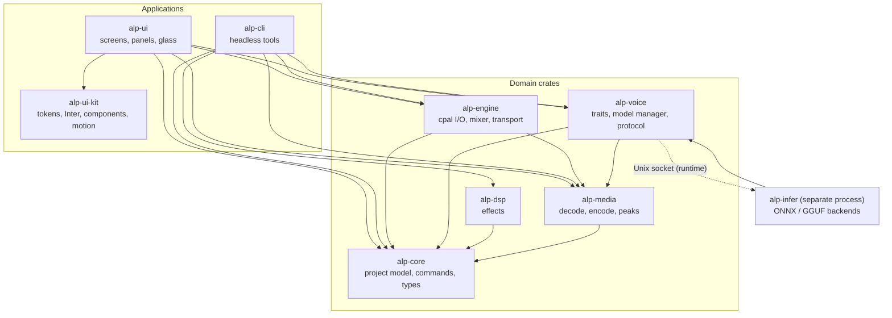

# Audio Lab Pro — architecture

Source of truth for crate boundaries and dependency directions. If this file and
`cargo metadata` disagree, the code or this document is wrong and must be fixed
in the same commit.

Status: Phase 1 complete (workspace, real-time engine, media pipeline, CLI and
guards). Phase 2 adds the glass shell and editing UI.

## Processes

| Process | Responsibility |
|---|---|
| `alp-ui` | One transparent OS window, floating panels, input, rendering. Never touches cpal or ONNX. |
| `alp-engine` (in-process audio thread) | cpal callbacks, mixer, transport, recorder. Real-time safe: no allocation, no locks, no logging. |
| `alp-infer` (separate process) | TTS/STT/clone models over ONNX Runtime and GGUF. Isolated so an OOM or GPU crash never kills the editor. Talks over a versioned Unix-socket protocol owned by `alp-voice`. |
| Worker pool | Decode, peak building, effect rendering, export. Cancellable jobs with progress channels. |


## Crate graph

Solid arrows are compile-time dependencies. The dotted arrow is the runtime
socket connection and must never become a Cargo dependency.



## Allowed dependency directions

Enforced by `scripts/check-deps.sh` from Phase 1.

- `alp-core` depends on no other ALP crate.
- `alp-media` and `alp-dsp` depend on `alp-core` only.
- `alp-engine` depends on core and media. Never on dsp, ui or voice.
- `alp-voice` depends on core and media. It reaches `alp-infer` only over the
  socket protocol.
- `alp-infer` depends on `alp-voice` (traits and protocol), core and media.
- `alp-ui-kit` has no ALP dependencies; in Phase 2 it adds iced and small
  presentation crates only.
- `alp-ui` depends on ui-kit, core, engine, media and voice. It never touches
  cpal, ONNX or GGUF directly.
- `alp-cli` depends on core, engine, media, dsp and voice. Never on ui.

### Phase 1 additions

- Phase 1 crates: `alp-core`, `alp-media`, `alp-engine` and `alp-cli` are
  implemented; `alp-dsp`, `alp-voice`, `alp-infer`, `alp-ui-kit` and `alp-ui`
  are boundaries with manifests, tests and docs.
- `scripts/check-deps.sh` compares these rules against `cargo metadata` on
  every CI run. `scripts/check-file-length.sh` and `scripts/check-docs.sh`
  enforce the source-size and module-documentation rules.
- The wayland glass/`ext-background-effect-v1` client will live in `alp-ui`
  behind a `glass` module (Phase 2). It is the only place that talks to the
  compositor beyond what iced/winit does.
- Peak cache format is owned by `alp-media`; UI reads it through a public type,
  never by parsing the file.

## Threading and real-time rules

| Context | May do | Must not do |
|---|---|---|
| UI thread | Render, input, cheap state updates | Decode, infer, block, wait on workers |
| Audio callback | Read pre-decoded buffers, mix, write the device buffer, drain `rtrb` commands | Allocate, lock, log, syscall, join, sleep |
| Worker pool | Decode, peaks, offline render, export | Touch the audio callback directly |
| `alp-infer` | Model load/inference, its own memory | Depend on UI state; hold the audio device |

Phase 1 measurements (release build, this machine):

| Check | Result |
|---|---|
| 1-hour mono 48 kHz WAV peak build | 1.42 s |
| same cache reopened | 0.013 s |
| eight simultaneous 60 s clips rendered | 2,880,000 frames in 1.5 s |
| 10 s device playback | 931 callbacks, 476,672 frames, no stream error |
| 10-minute eight-clip soak | see `docs/spikes/PHASE1-RESULTS.md` |

The Phase 0 evidence remains the reference for the compositor and inference
spikes (`docs/spikes/PHASE0-RESULTS.md`). The mixer is allocation-free by
construction; an automated allocator guard is tracked in ADR 0011 as a
follow-up.

## Non-destructive editing

- Source media is immutable; imports are copied into `media/`.
- A project is tracks → clips `{source_id, source_range, timeline_start, gain,
  fade_in, fade_out, envelope, effects[]}`.
- Every mutation is a `Command` with `apply`/`revert`; undo/redo is the stack.
- Playback, bounce and export walk the same clip graph and the same `Effect`
  implementations, so a null test can compare preview and render.

## Project format

Directory `*.alp/` containing `project.json` (versioned + migrations), `media/`,
`peaks/` (i16 min/max pyramid, 3 levels, ~3.4 MB per hour), `renders/` and
`voices.ref`. Saves are atomic: sibling temp file, `sync_all`, rename. A corrupt
or stale peak cache is rebuilt; it is never authoritative.

## Glass strategy

1. Transparent window with in-window floating panels (single OS window).
2. If the compositor offers blur **and** we can reach the Wayland surface,
   request blurred background for the panel region.
3. Otherwise keep the translucent tint plus an in-app frost gradient, which
   Phase 0 verified stays legible over arbitrary desktop content.
4. Motion is decorative: reduce-motion disables it; no motion ever encodes
   audio state.

Measured: window translucency works on niri/Wayland; niri advertises
`ext_background_effect_manager_v1`, but iced 0.14 exposes no window handle, so
blur cannot be requested yet. ADR 0003 accepts a minimal vendored `iced_winit`
patch in Phase 2 that publishes the `wl_surface`/`wl_display` pointers to a
`glass` module; until that lands, the tint fallback ships.

### Glass module boundary (Phase 2)

```text
alp-ui::glass
  ├─ detect()      enumerate compositor globals (probe code exists in spikes/)
  ├─ attach()      bind ext_background_effect_manager_v1 / X11 property
  └─ fallback()    tint + frost gradient when unavailable
```

It must remain the only place that touches platform windowing beyond iced, and
it must never block the audio thread or the UI frame.
