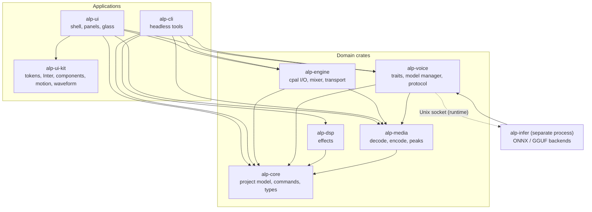

# Audio Lab Pro — architecture

Source of truth for crate boundaries and dependency directions. If this file and
`cargo metadata` disagree, the code or this document is wrong and must be fixed
in the same commit.

Status: Phase 2 complete (glass shell, component kit, floating panels, waveform,
command palette and persistence). Phase 1 foundation remains the base.

## Processes

| Process | Responsibility |
|---|---|
| `alp-ui` | One transparent OS window, floating panels, input, rendering. Never touches cpal or ONNX. |
| `alp-engine` (in-process audio thread) | cpal callbacks, mixer, transport, recorder. Real-time safe: no allocation, no locks, no logging. |
| `alp-infer` (separate process) | TTS/STT/clone models over ONNX Runtime and GGUF. Isolated so an OOM or GPU crash never kills the editor. Talks over a versioned Unix-socket protocol owned by `alp-voice`. |
| Worker threads | Decode, peak building, effect rendering, export. Cancellable jobs with progress channels; the Phase 2 UI uses the same pattern for its stubs. |

## Crate graph

Solid arrows are compile-time dependencies. The dotted arrow is the runtime
socket connection and must never become a Cargo dependency.



## Allowed dependency directions

Enforced by `scripts/check-deps.sh`.

- `alp-core` depends on no other ALP crate.
- `alp-media` and `alp-dsp` depend on `alp-core` only.
- `alp-engine` depends on core and media. Never on dsp, ui or voice.
- `alp-voice` depends on core and media. It reaches `alp-infer` only over the
  socket protocol.
- `alp-infer` depends on `alp-voice` (traits and protocol), core and media.
- `alp-ui-kit` has **no ALP dependencies**. It uses `iced` and `lilt` plus the
  Rust standard library only.
- `alp-ui` depends on ui-kit, core, engine, media and voice. It never touches
  cpal, ONNX or GGUF directly.
- `alp-cli` depends on core, engine, media, dsp and voice. Never on ui.

### Phase 2 additions

- `alp-ui-kit` implements tokens, bundled Inter, dark/light glass palettes,
  semantic controls, overlays, motion and the peak-pyramid waveform canvas.
- `alp-ui` implements the shell, eight floating-panel stubs, drag/resize/z-order/
  snap/collapse/dock, versioned workspace persistence, command palette and
  keyboard shortcuts, a cooperative worker queue, and the glass probe.
- `alp-media::PeakPyramid` is converted at the `alp-ui` boundary into
  `alp-ui-kit::waveform::WaveformPeaks`; the kit never links `alp-media`.
- `scripts/check-ui.sh` rejects a raw `iced::widget::button` in `alp-ui` (the
  component kit is the only button constructor).
- `scripts/check-file-length.sh` still enforces 1,500 lines; `app.rs` is close to
  the ceiling and should be split before the next feature.
- Peak cache format remains owned by `alp-media`; the UI reads it through a
  public type, never by parsing the file.

## Threading and real-time rules

| Context | May do | Must not do |
|---|---|---|
| UI thread | Render, input, cheap state updates, drain worker events | Decode, infer, block, wait on workers |
| Audio callback | Read pre-decoded buffers, mix, write the device buffer, drain `rtrb` commands | Allocate, lock, log, syscall, join, sleep |
| Worker threads | Decode, peaks, offline render, export, Phase 2 job stubs | Touch the audio callback directly |
| `alp-infer` | Model load/inference, its own memory | Depend on UI state; hold the audio device |

The UI subscribes to `window::frames()` only while a panel animates, the demo
transport plays, a job runs, or a diagnostic env var is set. When nothing moves
there is no redraw subscription, which is why idle CPU is zero. Worker progress
arrives over `std::sync::mpsc` and is drained with `try_recv()` from a frame.

Phase 1 measurements (release build, this machine):

| Check | Result |
|---|---|
| 1-hour mono 48 kHz WAV peak build | 1.42 s |
| same cache reopened | 0.013 s |
| eight simultaneous 60 s clips rendered | 2,880,000 frames in 1.5 s |
| 10 s device playback | 931 callbacks, 476,672 frames, no stream error |
| 10-minute eight-clip soak | see `docs/spikes/PHASE1-RESULTS.md` |

Phase 2 measurements (release build, this machine):

| Check | Result |
|---|---|
| 1-hour waveform autoscroll | 60–61 frames/s, 16.6 ms average frame time |
| idle CPU over 4 s | 0.00% (0 scheduler ticks) |
| idle RSS | about 88 MB |
| module/unit tests | 30 in `alp-ui`, 18 in `alp-ui-kit`; 104 workspace-wide |

The mixer is allocation-free by construction; an automated allocator guard is
tracked in ADR 0011 as a follow-up.

## Non-destructive editing

- Source media is immutable; imports are copied into `media/`.
- A project is tracks → clips `{source_id, source_range, timeline_start, gain,
  fade_in, fade_out, envelope, effects[]}`.
- Every mutation is a `Command` with `apply`/`revert`; undo/redo is the stack.
- Playback, bounce and export walk the same clip graph and the same `Effect`
  implementations, so a null test can compare preview and render.

## Project format

Directory `*.alp/` containing `project.json` (versioned + migrations), `media/`,
`peaks/` (i16 min/max pyramid, 3 levels, ~3.4 MB per hour), `renders/` and
`voices.ref`. Saves are atomic: sibling temp file, `sync_all`, rename. A corrupt
or stale peak cache is rebuilt; it is never authoritative.

The UI workspace is a separate `~/.config/alp/workspace.json`, also written
atomically. It stores schema version 1, theme, Reduce motion, last glass mode and
the eight panel geometries. A missing, corrupt or newer file is ignored in favour
of defaults.

## Glass strategy

1. Transparent undecorated window with in-window floating panels (one OS
   window). iced 0.14 exposes `window::run(id, |&dyn Window| …)`, so the app can
   read `RawWindowHandle` and `RawDisplayHandle` safely.
2. On KWin/X11, set `_KDE_NET_WM_BLUR_BEHIND_REGION` through `x11rb` for the
   window rectangle. Report `Glass: compositor blur` only after the property
   write succeeds.
3. Everywhere else paint the translucent tint (panel alpha ≥ 0.70) plus a darker
   root scrim. The fallback is legible without a compositor blur effect.
4. `ALP_FORCE_TINT=1` disables the blur attempt for testing and screenshots.
5. Motion is decorative: Reduce motion disables it; no motion ever encodes audio
   state.

Wayland `ext_background_effect_v1` remains unimplemented because attaching a
foreign display requires `unsafe`, and the workspace forbids unsafe code. This
is recorded in ADR 0012, which supersedes the vendor-patch assumption in ADR
0003. The current matrix is:

| Session | Result |
|---|---|
| niri/Wayland | transparent tint; no blur |
| GNOME/Wayland | transparent tint; no blur |
| KDE/X11 | KWin blur property + tint |
| KDE/Wayland | tint fallback (unless the app is run through an X11 handle) |
| other X11 | tint fallback |

### Glass module boundary

```text
alp-ui::glass
  ├─ probe()       read iced's raw window/display handles once
  ├─ resolve()     identify session/desktop and choose a mode for the report
  └─ x11 blur      set _KDE_NET_WM_BLUR_BEHIND_REGION for KWin
```

It is the only place that touches platform windowing beyond iced, and it must
never block the audio thread or the UI frame.
