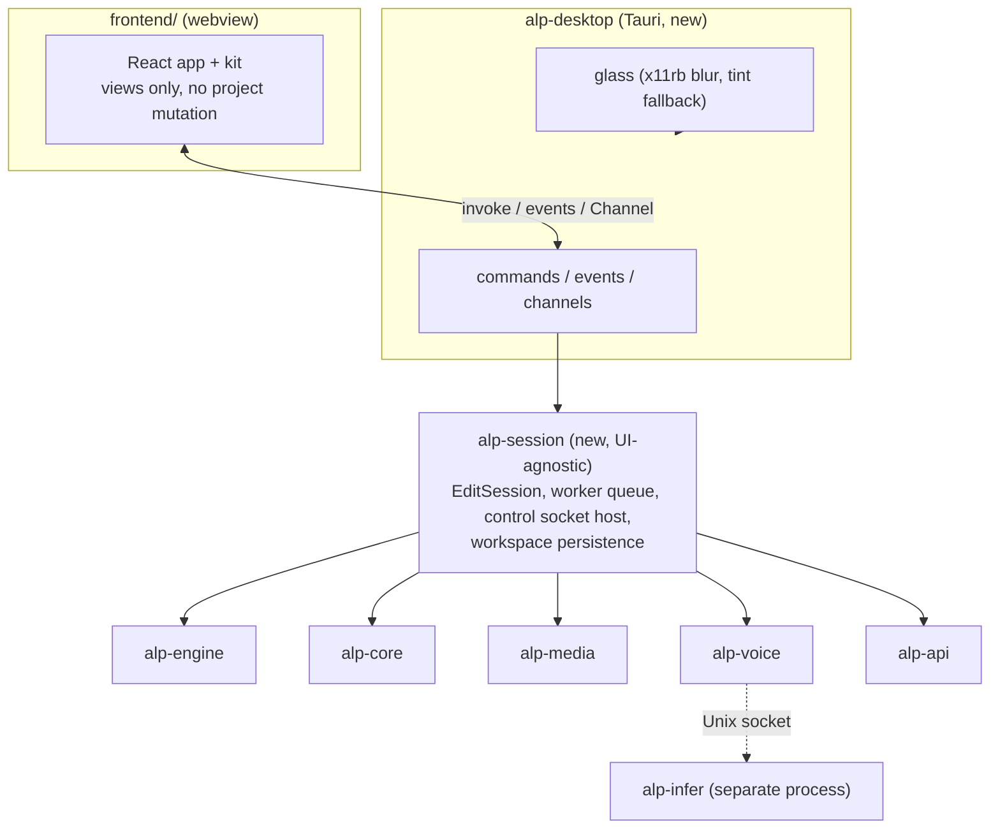

# Audio Labs Pro — UI Migration Plan: iced → Tauri 2 + React

Status: proposal · Supersedes the UI parts of ADR 0003 and ADR 0012 once accepted (record as [ADR 0013](../adr/0013-ui-migration-tauri.md)).

## 1. Goal

Replace the iced 0.14 desktop shell (`alp-ui`, `alp-ui-kit`) with a Tauri 2 shell and a React + TypeScript + Tailwind frontend, to reach the Voicebox / VoiceStudio level of visual polish. The audio engine, project model, DSP, media, voice and MCP layers do not change.

**Non-goals**
- No change to `alp-engine`, `alp-core`, `alp-dsp`, `alp-media`, `alp-voice`, `alp-infer`, `alp-plugin`, `alp-mcp` behaviour.
- No change to the `.alp/` project format or `~/.config/alp/workspace.json` schema (extend only, never break).
- No new features during the migration. Parity first, polish second.

## 2. Target stack

| Layer | Choice | Notes |
|---|---|---|
| Shell | Tauri 2 (Rust) | Replaces iced window + `winit` |
| Frontend build | Vite + React + TypeScript (strict) | |
| Styling | Tailwind CSS with design tokens in the theme | Tokens ported from `alp-ui-kit` |
| Components | Radix primitives (shadcn/ui as a starting kit) | All components live in `frontend/src/kit/` |
| Motion | Framer Motion (or Motion One) | Must honour Reduce motion |
| State | Zustand (view state) + Rust-owned project state | Frontend never owns project truth |
| Command palette | cmdk | Replaces the Ctrl+K palette |
| Waveform / timeline | Canvas 2D first, WebGL if the spike demands it | WaveSurfer.js only for simple previews |
| Font | Inter, bundled locally | No CDN, app stays fully offline |
| Rust ↔ TS types | One generator, chosen in the ADR (`tauri-specta` or `ts-rs`) | No hand-written duplicate types |
| Tests | Vitest, Testing Library, Playwright (mocked IPC), `tauri-driver` for E2E | |

## 3. Target architecture

**Crate changes**
- **New `alp-session`**: everything in `alp-ui` that is not rendering (live `EditSession`, worker queue, hosting of the `alp-api::control` socket, workspace persistence, revision-tagged snapshots for attached MCP edits). Depends on core, engine, media, voice, api. **Must not depend on iced or tauri.**
- **New `alp-desktop`**: Tauri app, IPC glue, window setup and the glass module. Depends on `alp-session` only.
- **New `frontend/`**: the React app (not a Rust crate).
- **Removed after cutover**: `alp-ui`, `alp-ui-kit`, and the iced / lilt / iced-cube workspace dependencies.

## 4. Rules carried over

- Views send commands and never mutate project state. In React, components dispatch IPC commands and render what Rust reports.
- Real-time rules are unchanged: the audio callback never allocates, locks or logs, and the webview never touches the audio thread.
- No file over 1,500 lines (soft limit 1,000), now enforced for `.ts` and `.tsx` too.
- Every module gets its own page in `docs/modules/`, including frontend feature folders.
- Inter font, motion across the UI, a Reduce motion switch, and a legible tint fallback when blur is unavailable.
- Motion is decorative and never encodes audio state.

## 5. IPC contract

| Direction | Mechanism | Used for |
|---|---|---|
| TS → Rust | `invoke` commands | Transport, edits (`DeleteRange`, `PasteClips`, ...), generate, import, export, settings |
| Rust → TS | Events | Project revision changed, job progress, model download progress, AI-attach activity |
| Rust → TS | `Channel` (batched) | Input/output meters at about 30 Hz, dictation partials |
| Rust → TS | Raw binary `ipc::Response` | Peak pyramid levels, never JSON |

Rules:
- **Playhead**: do not emit per frame. Send an anchor (`position`, `timestamp`, `rate`) on transport changes and interpolate in `requestAnimationFrame`.
- **Project state**: Rust holds the truth; the frontend keeps a revision-tagged mirror and refetches or patches when the revision changes.
- **Errors**: every command returns a typed error enum; the UI maps it to the same explanatory dialogs as today.

## 6. Phases

Sizes: S ≈ days, M ≈ 1–2 weeks, L ≈ several weeks (solo, agent-assisted).

### M0 — Feasibility spike (size S) — GO / NO-GO gate
Build a throwaway Tauri window and measure it against the iced baseline from `../spikes/`.
- Transparent, undecorated window on KDE/X11, KDE/Wayland, niri, GNOME/Wayland.
- KWin blur: set `_KDE_NET_WM_BLUR_BEHIND_REGION` with `x11rb` on the Tauri window's X11 handle (safe code only).
- CSS `backdrop-filter` inside WebKitGTK over a transparent window: check what it actually blurs.
- Canvas waveform of a 1-hour file, autoscrolling.

| Metric | iced baseline | Proposed gate |
|---|---|---|
| 1-hour waveform autoscroll | 60–61 fps, 16.6 ms | ≥ 55 fps |
| Idle CPU (4 s) | 0.00% | < 1% |
| Idle RSS | about 88 MB | record it; no hard gate |
| Glass on KWin/X11 | compositor blur | blur works, or tint is legible |

If the gate fails: try WebGL for the waveform. If WebKitGTK is still the blocker, evaluate Electron as the fallback, or stay on iced and restyle.

### M1 — Extract `alp-session` (size M)
- Move all non-rendering logic out of `alp-ui` into `alp-session`; `alp-ui` becomes a thin iced adapter.
- Split `app.rs` while doing this (it is near the 1,500-line ceiling).
- Add `alp-session` to `scripts/check-deps.sh` with the rule "no iced, no tauri".
- **Exit:** all 144+ tests pass, iced app behaves identically, MCP attach still works.

### M2 — Tauri shell + frontend scaffold (size M)
- Create `alp-desktop` and `frontend/` (Vite, React, TS strict, Tailwind).
- Wire one end-to-end command and one event; generate TS types from Rust.
- Check `unsafe_code = "deny"` against Tauri's macro output: keep workspace-wide deny. M2 first checks whether Tauri's generated code actually trips the lint; if not, no exception exists. If it trips, scope the exception to `alp-desktop` only at the narrowest level (macro-generated item, not crate). Hand-written code in `alp-desktop` must contain zero `unsafe` (glass and window code use safe `x11rb` and `raw-window-handle`). Record every exception in ADR 0013 with reason, item, and Tauri version; re-check on upgrades.
- Port the design tokens: neon hues per workspace, dark and light glass palettes, contrast rules, spacing, radii, elevation.
- Early Flatpak de-risk: build a throwaway Flatpak manifest with the Tauri skeleton and confirm audio (PipeWire/ALSA), file access, and model-directory access work.
- **Exit:** the window opens with the iced-equivalent background, token page renders, CI builds both apps, and throwaway Flatpak manifest builds and plays a test tone.

### M3 — Kit + app shell (size M)
- Build `frontend/src/kit/`: buttons, toggles, sliders, inputs, tabs, dialogs, tooltips, menus, meters, cards. Everything goes through the kit.
- Icon rail with the seven workspaces, routed with Ctrl+1…8 shortcuts.
- Floating panels: drag, resize, z-order, snap, collapse, dock (pick the library in the ADR rather than hand-rolling).
- Command palette (Ctrl+K), shortcuts modal (F1), theme cycle (Ctrl+D), Reduce motion (Ctrl+Shift+M).
- Reuse `workspace.json` through `alp-session`.
- **Exit:** shell navigation and panel layouts match the current app and persist across restarts.

### M4 — Transport, meters, waveform (size M)
- Docked player wired to the engine through `alp-session`.
- Meters over `Channel`; playhead by anchor and interpolation.
- Waveform component fed by binary peak levels (peak-pyramid level selection by zoom).
- **Exit:** 1-hour autoscroll meets the M0 gate inside the real app; 10-minute playback shows no dropped callbacks.

### M5 — Workspace ports (size L)
Port in this order, lowest risk first. Each one ships behind a flag until it reaches parity.
1. Settings, 2. Models, 3. Voices (with the cloning consent gate, unchanged), 4. Generate, 5. Effects (including hosted CLAP/LV2 card), 6. Captures (recording, dictation, transcript editor), 7. Stories.

For each: screenshot parity review, keyboard parity, Reduce motion check, docs page.

### M6 — Multitrack timeline editor (size L)
The riskiest piece, so it comes after everything else is stable.
- Canvas (or WebGL) timeline: clips, fades, envelopes, markers, loop range, selection.
- Every edit is an IPC command that maps to an existing `alp-core` `Command`; undo/redo stays in the Rust command stack.
- Hit-testing and drag logic live in a framework-free TS module with unit tests.
- **Exit:** all editing shortcuts from [`docs/KEYBOARD_SHORTCUTS.md`](../KEYBOARD_SHORTCUTS.md) work, redo restores the same clip ids, null tests still pass.

### M7 — AI/MCP parity (size M)
- Frontend subscribes to session events so attached MCP edits appear live and commit as one undo entry.
- Keep revision-tagged scratch snapshots and authenticated subscriptions as they are.
- **Exit:** the `alp-mcp --attach` workflows in [`docs/mcp/`](../mcp/) pass unchanged.

### M8 — Packaging and cutover (size M)
- `.deb` / `.rpm`: add WebKitGTK runtime dependencies (verify the exact package names per distro).
- **Flatpak**: the current manifest uses the Freedesktop 24.08 runtime, which does not ship WebKitGTK. The current Freedesktop 24.08 runtime stays for the iced build until M8. At M8, move the manifest to a runtime that ships WebKitGTK (GNOME runtime family). Runtime version: verify the currently supported GNOME runtime and that it provides webkit2gtk-4.1 at M8 time (do not hardcode a specific version). Re-verify size and audio access.
- Update AppStream metadata, [`docs/TROUBLESHOOTING.md`](../TROUBLESHOOTING.md) (WebKitGTK, NVIDIA, Wayland), and [`THIRD_PARTY.md`](../../THIRD_PARTY.md) for the npm dependency tree (license check).
- Remove `alp-ui`, `alp-ui-kit` and iced dependencies; replace `check-ui.sh`.
- **Exit:** a tagged alpha release passes the full CI gate plus the manual acceptance list below.

## 7. Glass strategy under Tauri

1. Transparent undecorated Tauri window; panels are DOM elements.
2. KWin/X11: set the blur property from Rust (`x11rb`, safe code) using the window's X11 handle.
3. Everywhere else: translucent tint (alpha ≥ 0.70) plus a darker root scrim, as today. `ALP_FORCE_TINT=1` keeps working.
4. CSS `backdrop-filter` only blurs content inside the webview, so treat it as an inner-panel effect, not as desktop blur. Verify in M0.
5. Wayland `ext_background_effect_v1` stays out of scope, as in ADR 0012.

## 8. Guards and CI changes

| Today | After migration |
|---|---|
| `check-ui.sh` (no raw iced widgets outside kit) | ESLint rule banning raw `<button>`, `<input>` etc. outside `frontend/src/kit/` |
| `check-file-length.sh` (Rust) | Extend to `.ts` / `.tsx` |
| `check-deps.sh` | Add `alp-session`, `alp-desktop`; forbid iced and tauri in `alp-session`; check-deps.sh or a new check fails if `unsafe` appears in hand-written alp-desktop source |
| `check-docs.sh` | Also require a page per frontend feature folder |
| fmt, clippy, tests | Add `tsc --noEmit`, ESLint, Vitest, Playwright |

## 9. Risks and mitigations

| Risk | Mitigation |
|---|---|
| WebKitGTK performance or blur differs across distros | M0 gate; test KDE, GNOME, niri early; keep tint fallback |
| Timeline performance in the DOM | Canvas/WebGL only for the timeline; no per-clip DOM nodes |
| IPC overhead for meters and peaks | Batched `Channel`, binary responses, interpolated playhead |
| Dual UI maintenance during migration | Time-box: iced stays frozen (bug fixes only) from M2 |
| Flatpak runtime change | Handle in M8 (runtime version: verify the currently supported GNOME runtime and that it provides webkit2gtk-4.1 at M8 time; Freedesktop 24.08 stays until M8); early de-risk in M2 builds throwaway manifest and verifies audio playback |
| npm supply-chain and license surface | Lockfile, `npm audit` in CI, license check feeds `THIRD_PARTY.md` |
| `unsafe_code = "deny"` vs Tauri macros | Workspace deny stays; M2 verifies if macros trip it; if so, item-level exception only, zero unsafe in hand-written code, verified by guard |

## 10. Manual acceptance checklist (before removing iced)

- [ ] All seven workspaces reach feature parity with the iced build
- [ ] Layout, theme and Reduce motion persist across restarts
- [ ] 30-minute capture soak: 0 dropped samples with the new UI running
- [ ] Forced-kill capture recovery still works
- [ ] WAV/FLAC null test unchanged
- [ ] MCP attach workflows pass
- [ ] Idle CPU and 1-hour waveform scroll meet the gates
- [ ] `.deb`, `.rpm` and Flatpak install and run on a clean machine

## 11. Rollback

Keep the iced crates in the workspace until M8 passes. If a gate fails, `main` still builds and ships the iced app. Each phase merges behind a feature flag or a separate binary (`alp-desktop` alongside `alp-ui`).

## 12. Agent rules for this migration

- One phase at a time; stop at each exit criterion and report measurements.
- Never change behaviour in the engine, core or session crates except to extract code in M1.
- Update [`docs/architecture/ARCHITECTURE.md`](ARCHITECTURE.md) in the same commit as any crate or IPC change.
- Every new module gets its [`docs/modules/`](../modules/) page; every decision that supersedes an ADR gets a new ADR.
- Do not add dependencies without listing them in [`THIRD_PARTY.md`](../../THIRD_PARTY.md).

## 13. M8 documentation debt

Checklist of documentation updates deferred until M8 cutover (do not edit these files before M8):
- [ ] `docs/TROUBLESHOOTING.md`: WebKitGTK runtime dependencies per distro (verify package names), hardware acceleration, NVIDIA/Wayland webview issues (verify exact flags and env vars before writing; do not guess them).
- [ ] `docs/USER_GUIDE.md`: build/run target changes from `-p alp-ui` to `-p alp-desktop`; the installed binary name `audio-labs-pro` stays the same; document the React UI workflows.
- [ ] `docs/KEYBOARD_SHORTCUTS.md`: shortcut PARITY only. The cmdk palette keeps Ctrl+K, and F1, Ctrl+1..8, Ctrl+D, Ctrl+Shift+M stay as they are. Any intentional change needs its own ADR note.
- [ ] `THIRD_PARTY.md`: npm dependency licences, Tauri 2 crates, WebKitGTK packages; produced from a lockfile-based licence report, not by hand.
